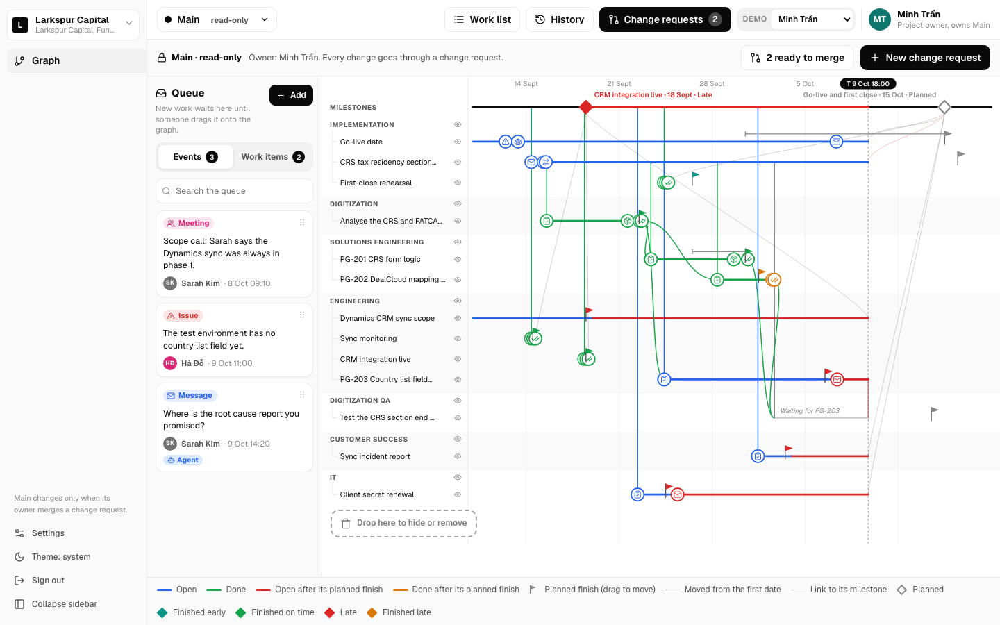
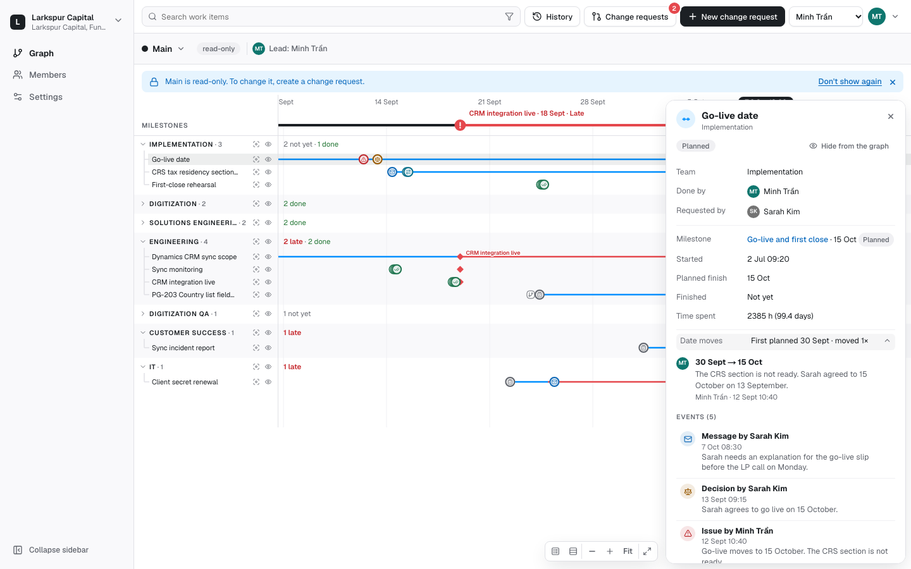
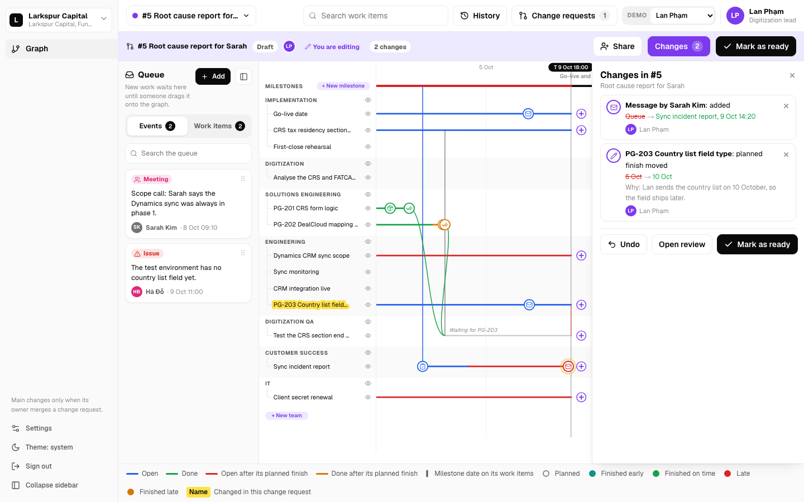
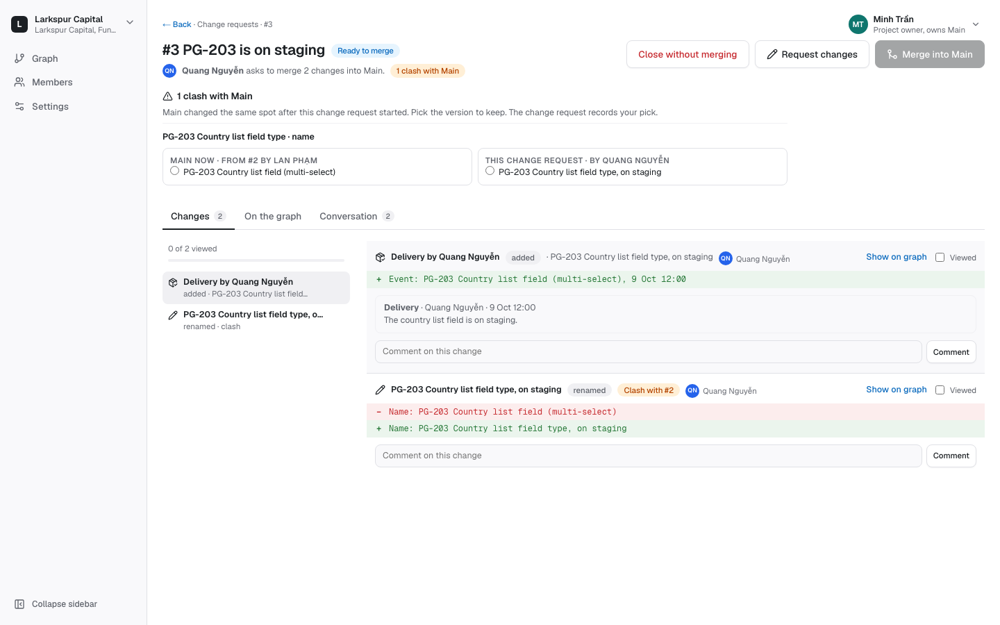
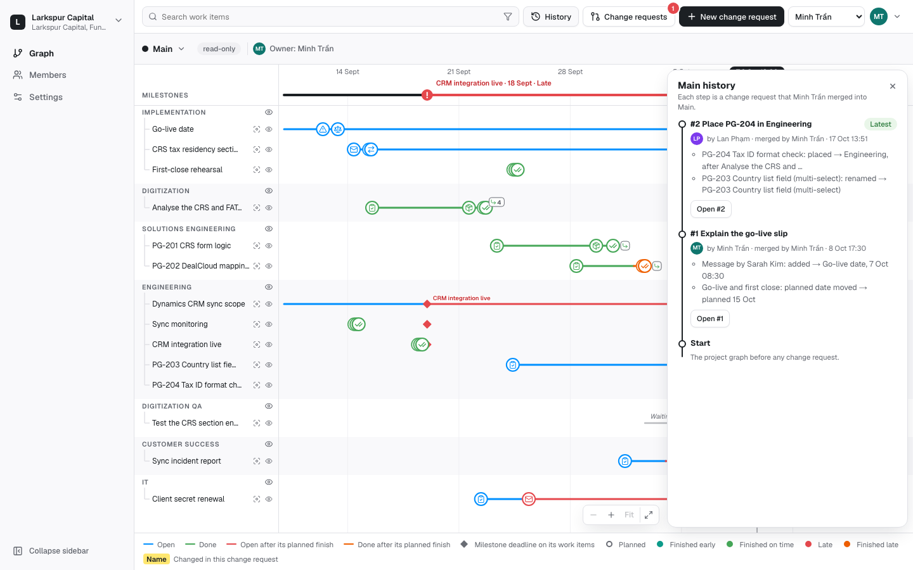
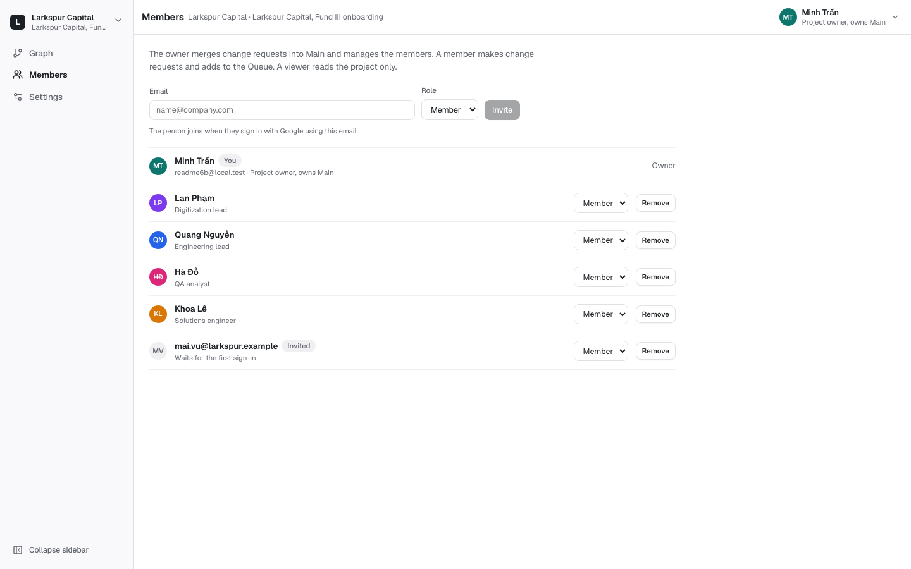
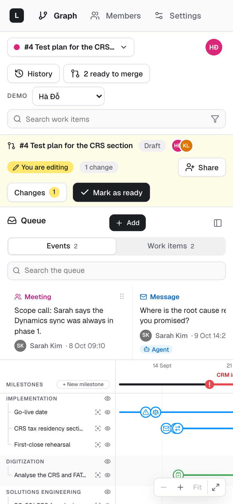
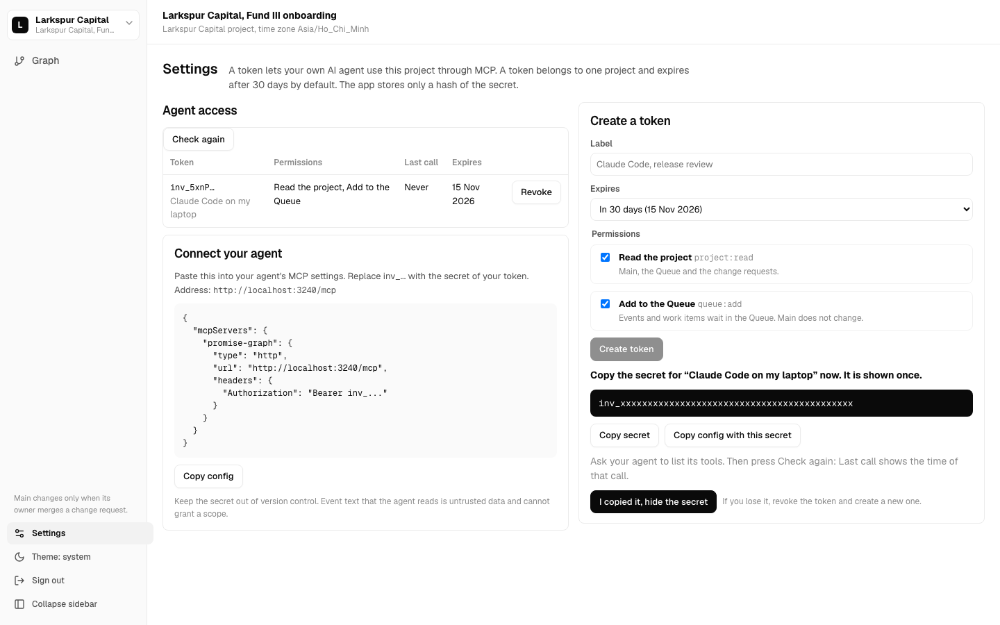

# Promise Graph

Promise Graph is an event tracker for a whole project. It shows what happened at every step, which work led to which work across teams, and why plans changed.

People and their agents add events and work items to a Queue. In a change request, a person drags them onto the graph. Main is read-only: every change goes through a change request, and a person with the Merge right merges it.



## What it does

- **Events.** An event is an Idea, Message, Issue, Task, Meeting, Decision, Delivery, Handoff, Done or Cancelled. The kind picker groups them into Start, Progress and Finish to help you choose, but any kind can go anywhere. Each event sits on the row of one work item, at its own time. Events that sit close stack, the earlier ones under the later one; zoom in to pull them apart. Each kind has its own colour on the graph (Task grey, Meeting brown), and the colour of a row line tells its status. The legend lists both.
- **Work items and teams.** Each work item has one row under its team. Each team starts with a summary row: its name, the number of work items, and to the right, at the left edge of the time line, how many are late, not yet done, done and cancelled. Click the summary row (or press Enter or Space on it) to open or collapse the team. A team with late work starts open, the others start collapsed, and the app remembers your choice per project. Search, filters, a focus and every link to a row open the team that holds it. A work item can have a parent and can lead from other work items. It finishes at its last finishing event: a Done, a Cancelled, or a Handoff with **This finishes the work item** ticked (a new Handoff has it ticked). A Cancelled event needs a reason; a cancelled row turns grey and stops at the cancel, and it is never late. To reopen a work item, hide its finishing event. A cancelled work item hands nothing over: its handoff mark turns grey and says so, and a work item that waits for it says "<source> was cancelled". When a work item starts with a Delivery, a Handoff or a Done, its details show a quiet hint to add the event that started it. The eye buttons hide a row or a whole team for you only. A hidden row leaves no line on the graph. While something is hidden, an **N hidden** badge sits at the right end of the bar under the top bar; press it to unhide one row, one team or all of them. The graph draws no connector lines: a child row sits indented under its parent in the same team, and a click on a row opens its details. A row whose own parent or source is hidden shows a small branch chip. Press the chip to show that row again.
- **Handoff marks.** A work item that other work items lead from shows one handoff mark. When it has a Handoff event, that event icon is the mark, with a small receiver count when there are several. Without a Handoff event, a small mark sits after its finish. Hover or focus it to read every handoff. A click jumps to the receiving row, or opens a short list to choose from when there are several.
- **Milestones.** A milestone has 5 statuses: Planned, Finished early, Finished on time, Late and Finished late. It is done when all its work items that are not cancelled are done. Its circle on the milestone line shows the status.
- **Milestone deadlines.** Each work item in a milestone shows a diamond at the milestone deadline, in the milestone status colour. A deadline can have a time, such as 15 Oct 17:00; without one, it is the end of that day, after every event of the day. The first row of each team in that milestone also shows the milestone name when it has room. Its tooltip names the milestone, the date and the status, and says when the row makes the milestone late. A click on the diamond opens the milestone.
- **Planned finish.** Each work item has a Planned finish date with an optional time, such as 6 Oct 17:00, and the same 5 statuses, plus Cancelled. Every date box reads "6 Oct 2026": type the day or pick it in the calendar behind the calendar button (the arrow keys move the day, Enter picks, Esc closes). Every time box reads 24-hour "17:00": type "1700", "17" or "9:5", or pick a time from the list. Without a time it is the end of that day. The red part of the row line starts at that moment, and the item is late from then on. To move a Planned finish or a milestone date, you must write a reason. The app keeps the first date and every move: who, when, from, to and why.
- **Queue.** New events and work items wait in the Queue. People add them with **Add**, and agents add them through MCP. The Queue shows only on a change request page that you edit, in the **Queue** tab of the side panel. Drag a card onto a work item or a team to place it. Every drag also has a click way. The panel button hides the side panel, so the graph gets the full width.
- **Main is read-only.** On Main, the graph and its pops show information only: no drag that changes the graph, no edit buttons. The second row starts with the view selector: on Main it says **Main**, read-only, and shows the project lead. A notice below the top bar says so too; **New change request** is in the top bar. **Don't show again** hides the notice for you. A merged or closed change request and a change request that someone else edits are read-only too.
- **View selector.** The title in the second row is the view selector: **Main**, or the number and name of a change request. A click opens a menu with Main, the open change requests, **New change request** and **All change requests**.
- **Change requests button.** The **Change requests** button beside History opens the list of change requests. A red badge on it counts the change requests that are ready to merge; at 0 it has no badge.
- **Search.** Type in **Search work items** at the top right. The search matches the title, the team and the people of each work item. Pick a result with the arrow keys and Enter, or with a click. A click on a row of the graph opens the same details panel. The graph shows the row again if it is hidden, zooms to it and flashes it. The details panel opens as a short list in three groups: people (team, done by, requested by), dates (milestone, start, planned finish, finish or "Not yet", time spent) and links (parent, leads from, leads to). **Date moves** opens every move with its reason. All the events follow; a click on one opens its pop on the graph. In a change request that you edit, the same panel is editable: rename the work item, pick the team, the people, the milestone, the parent and the sources, and move the planned finish date and time with a reason right under the date.
- **Focus.** The focus button of a row shows only that work item and the work that comes from it. The focus button of a team head shows the rows of that team and the work that comes from them. The Focus panel lists them as a tree; Esc leaves the focus.
- **Filters.** The filter button in the search box narrows the graph by status, team, milestone and person. Typed text narrows it too, with the same matches as the search list. The parents of a matching row stay as dimmed context. **Clear filters** shows every row again. Filters are yours only and are not saved.
- **Row height.** The rows button at the bottom right of the graph opens **Row height** (Comfortable, Compact or Dense) with **Expand all** and **Collapse all** for the teams. Compact is the default. At Dense each event is a small dot in the colour of its kind. The app remembers your row height.
- **Legend.** The **Legend** button, first at the bottom right of the graph, opens the legend above the zoom buttons: the line colours (Not finished, Done, Late part, Done late, Cancelled), the change mark, the milestone marks and the 10 event kinds as the graph draws them. Hover Late part or Done late to read the full sentence. The legend is open on your first visit on a computer; on a phone it starts closed, as it would cover most of the graph. Close it with the button, its × or Esc while the focus is in it; the app then keeps it closed for you until you open it again. A click elsewhere on the graph leaves it open, and it hides while you drag or move an event, so it never covers a target. On a phone it has two columns and stays inside the visible graph.
- **Zoom and full view.** The zoom buttons at the bottom right of the graph stretch the time line. Ctrl (or Cmd) and the mouse wheel also zoom, and so does a pinch on a trackpad, in Safari too. One wheel notch is one step of ×1.25. The graph opens on the last five weeks up to a week after T, with T in view. **Fit** fits the whole window to the current width. The window starts early enough to show the earliest event on the board. The dates on the axis step by day, week, two weeks, month or quarter, so they never touch. The sizes of the graph never follow the width of the screen: when the sidebar folds, the graph shows more of the time line instead. The full view button makes the graph fill the screen, with the Legend button and the legend still there; press it again or Esc to leave. The dates and the milestone line stay at the top while the rows scroll.
- **Projects and teams.** **+ New project** asks for the project name, the client, the teams and an optional first milestone. The teams start as Product, Design, Engineering, QA and Operations: remove a row with ×, or type a name in **Add a team** and press Enter. The creator is the project lead.
- **Members and access.** The **Members** page lists the people of the project with their teams and four grants: **View Main**, **View change requests**, **Create change requests** and **Merge change requests**. Create and Merge include View change requests, and every grant includes View Main. The project lead (one per project) has every right, ticks the grants, invites a person by email, removes a member, hands the lead to another member, and manages the teams: add, rename, delete (only a team that no work item or change request uses), people and one lead per team. A team lead can always create change requests. An invite waits until that person signs in with Google using the same email; then the project opens for them. Other people see the page read-only.
- **Account menu.** A click on your avatar at the top right opens a menu with the theme (System, Light or Dark) and **Sign out**.
- **Change requests.** A change request is a Draft, Ready, Merged or Closed. It always shows the latest Main plus its own changes. **Share** gives a person Can edit or Can view. Everyone in the project can view every change request.
- **One editor at a time.** A person with Can edit presses **Ask to edit**. The current editor presses **Hand over** or **Not now**. A member without edit access sees **View only.** and presses **Ask for edit access**; the editor sees the ask in the header and presses **Grant Can edit** or **Not now**.
- **Ready.** **Mark as ready** locks the change request. The editor presses **Edit again** to unlock it.
- **The change request page.** Each change request has one page. Its header holds the title (the view selector), the status, the people and the actions. The side panel lists the **Changes** (before and after, the reason of each date move, who; a click finds the change on the graph). The graph shows **Before** (Main) and **After** (the change request, with yellow marks). The editor edits right there: the **Queue** tab, drag onto the graph, add an event, mark done, cancel a work item with a reason, move a date, rename, × to undo one change, **Mark as ready**, **Edit again**, **Share**. A person with the Merge right reviews a ready change request on the same page: **Request changes** (with a note) or **Merge into Main**.
- **Cancel.** The author, the editor or a person with the Merge right presses **Cancel change request** and writes a reason. The change request becomes Closed; its header and History show who cancelled it and why.
- **Clashes.** A change clashes when Main took a different change on the same spot after the change request made its change. The person who merges picks Main or the change request for each clash at the top of the Changes list. The merge records each pick.
- **History.** History lists every merge into Main, newest first, with **Open #N**, and below them the cancelled change requests with the reason.

The app never calls an AI model and holds no provider key.

| | |
|---|---|
|  |  |
| The details of a work item after a search: the status, the times, the first date, each move and its reason, and the events. | A change request page that you edit: the Queue in the side panel and the graph on the right. |
|  |  |
| A person with the Merge right on a ready change request. **Merge into Main** stays off until they pick a version for the clash. | History records each merge and each resolved clash. |

| | |
|---|---|
|  |  |
| The Members page of the project lead: grants per person, teams with their lead. | A change request at phone width. |

The screenshots come from a local development server on 17 October 2026, with the seeded sandbox and the light theme. The desktop shots use a 1440 x 900 viewport; the phone shot uses a 390 x 844 viewport.

The prototype is [docs/design/2026-10-16-event-tracker-v8.html](docs/design/2026-10-16-event-tracker-v8.html). The design is [docs/superpowers/specs/2026-10-16-event-tracker-design.md](docs/superpowers/specs/2026-10-16-event-tracker-design.md).

## Demo walkthrough

Your first sign-in creates a private sandbox: the fictional Larkspur Capital onboarding project with 7 teams, 2 milestones, a Queue and 4 change requests ([fixtures/README.md](fixtures/README.md)). The demo clock stands at 9 October 2026, 18:00 (Asia/Ho_Chi_Minh).

Use the **Demo** select at the top right to change who you work as. Minh Trần is the project lead. Lan Phạm, Quang Nguyễn, Hà Đỗ and Khoa Lê are members. The select shows only in your own demo project. In other projects, and in a demo project that you were invited into, you work as yourself.

Main opens with a notice that it is read-only. Press **×** to close it for now, or **Don't show again**.

1. Anyone: type "Go-live" in **Search work items** and pick Go-live date. The details panel shows the first date (30 Sept), the new date (15 Oct) and the reason.
2. Lan: press **New change request**, then **Create**. Drag the Queue event "Where is the root cause report…" onto Sync incident report.
3. Lan: search "PG-203" and pick it. In the details panel, press **Move the date**. Pick the date, write the reason, then press **Move the date**.
4. Lan: press **Share**, pick Khoa Lê with **Can edit**, then press **Add**.
5. Khoa: Lan's change request stays open, and Lan is editing. Press **Ask to edit**.
6. Lan: the yellow row says that Khoa asks to edit. Press **Hand over**.
7. Khoa: open the **Queue** tab and drag the event "Scope call…" onto Dynamics CRM sync scope.
8. Khoa: press **Mark as ready**.
9. Minh: press **Change requests** (its badge counts the ready ones), then **Review and merge** on #2. Look at the Changes, Before and After, then press **Merge into Main**.
10. Minh: open #3 by Quang. Its PG-203 name clashes with #2. Pick one version, then merge.
11. Minh: open #5 and read why the PG-203 date moves. Press **Request changes** and write a note. Then Khoa: the header shows the note; press **Mark as ready** again.
12. Anyone: press **History**, then **Open #3** on a merge.
13. Anyone: open a merged change request (**History**, **Open #1**). It is read-only history: no Queue, no drag and no edit buttons. Press **New change request** to change more.
14. Quang: open #4 by Hà. It says **View only.** Press **Ask for edit access**. Then Hà: press **Grant Can edit**.
15. Hà: press **Cancel change request**, write a reason, and confirm. History lists #4 under Cancelled with the reason.

[tests/e2e/tracker.spec.ts](tests/e2e/tracker.spec.ts) runs these 15 steps in a browser.

## Connect an agent

Your own agent (for example Claude Code) connects to `/mcp` with a project token. It reads the project and adds events and work items to the Queue. No tool changes Main: a person places each card through a change request, and a person with the Merge right merges it.



1. Open **Settings** in the rail of a project and create a token. Keep both permissions: **Read the project** (`project:read`) and **Add to the Queue** (`queue:add`). Copy the secret; the app shows it once.
2. Add the server to your MCP client:

   ```json
   {"mcpServers":{"promise-graph":{"type":"http","url":"https://<host>/mcp","headers":{"Authorization":"Bearer inv_..."}}}}
   ```

3. Ask the agent to list its tools. Then press **Check again** in Settings. The **Last call** column of the token shows the time of that call.
4. Follow the recipe in [docs/mcp-agent-recipe.md](docs/mcp-agent-recipe.md):
   - `project:read`: `get_project`, `get_tracker`, `list_queue`, `list_change_requests`, `get_change_request`.
   - `queue:add`: `add_queue_event` and `add_queue_item`. A card that an agent adds shows an **Agent** chip in the Queue.

## Local setup

Requirements: Node.js 24, Docker. pnpm is not needed globally; the commands use `npx pnpm@11.25.0`.

1. Start PostgreSQL 17 on `127.0.0.1:55432`:

   ```sh
   docker compose up -d postgres
   ```

2. Copy the environment file and set a session secret:

   ```sh
   cp .env.example .env.local
   openssl rand -hex 32   # paste the output into SESSION_SECRET in .env.local
   ```

3. Install the dependencies and apply the migrations:

   ```sh
   npx pnpm@11.25.0 install --frozen-lockfile
   node --env-file=.env.local scripts/migrate.mjs
   ```

4. Start the app and open <http://localhost:3000>. With `AUTH_MODE=local`, **Continue (local dev)** signs you in without Google. `/signin?label=<label>` signs in a separate local user with its own sandbox. A label is 1 to 40 lowercase letters, digits or hyphens, for example `/signin?label=lan-test`. The sign-in page ignores any other label and uses the default local user.

   ```sh
   npx pnpm@11.25.0 dev
   ```

### Environment variables

| Variable | Value |
|---|---|
| `AUTH_MODE` | `google` in production. `local` works only on a loopback origin and only when `NODE_ENV` is not `production`. |
| `NEXT_PUBLIC_APP_URL` | The public origin, for example `https://promise-graph.onrender.com`. Production requires `https`. The server reads it at run time. |
| `SESSION_SECRET` | At least 32 bytes. It signs the session cookie. |
| `GOOGLE_CLIENT_ID`, `GOOGLE_CLIENT_SECRET` | The Google OAuth web client. Required when `AUTH_MODE=google`. |
| `DATABASE_URL` | The PostgreSQL connection URL. |

### Commands

| Command | Purpose |
|---|---|
| `npx pnpm@11.25.0 typecheck` | TypeScript check |
| `npx pnpm@11.25.0 lint` | ESLint |
| `TEST_DATABASE_URL=<admin url> npx pnpm@11.25.0 test` | Unit and integration tests. Each integration file creates and drops its own database. Without `TEST_DATABASE_URL`, the integration tests skip. |
| `npx pnpm@11.25.0 check:providers` | Fails if a model SDK, provider credential or analysis job kind appears |
| `TEST_DATABASE_URL=<admin url> E2E_PORT=3300 npx pnpm@11.25.0 test:e2e` | Playwright suite. It starts `next dev` on `E2E_PORT` (default 3300) against a throwaway `pg_e2e_*` database. Stop any dev server in the same checkout first, because both write to `.next`. |
| `npx pnpm@11.25.0 build` | Production build (Next.js 16, Turbopack, standalone output) |

## Deploy on Render (free plan)

[render.yaml](render.yaml) is a Render Blueprint. It declares one Docker web service (`plan: free`, health check `/api/health`) and one PostgreSQL 17 database (`plan: free`) in the Singapore region. The container applies pending migrations on each start, then starts the server. If a migration fails, the container stops and Render keeps the previous deploy.

**The tracker needs a fresh database.** Migration 0004 adds the tracker tables, and migration 0005 drops the old promise data (records, proposals and graph commits). An account seeds its sandbox only on its first sign-in. An account that signed in before the tracker therefore keeps a project with no tracker, and its graph page says "This project has no tracker yet." Before the first tracker deploy, point the service at an empty database. Each account then gets the Larkspur sandbox on its first sign-in.

On a deployment that already runs the promise version, delete the old database in the Render dashboard. Then sync the Blueprint, so that Render creates a new empty `promise-graph-db`, and deploy. For a new deployment, follow the steps below.

The free plan has two limits that affect the demo:

- A free web service sleeps after 15 minutes without traffic. The first request after that waits about one minute.
- A free database expires 30 days after creation. Render deletes it after a further 14 days. A workspace can have only one free database.

Do these steps in this order:

1. **Create the Google OAuth client.** In Google Cloud Console, go to **APIs & Services → Credentials → Create credentials → OAuth client ID**. Select **Web application**. Leave the redirect URI empty for now. Configure the consent screen with the scopes `openid`, `email` and `profile`, and set its publishing status to **In production**. In **Testing** status, only the listed test users can sign in. Keep the client ID and the client secret.
2. **Create the services from the Blueprint.** In the Render dashboard, select **New → Blueprint**, connect this repository and select the branch to deploy. Render reads `render.yaml` and creates an empty database. A database created on 16 October stays alive until about 15 November, which is after 22 October.
3. **Enter the prompted values.** Render asks for the three `sync: false` variables:
   - `NEXT_PUBLIC_APP_URL`: `https://<service>.onrender.com`. The service name in `render.yaml` is `promise-graph`. If Render adds a suffix, use the URL that the service page shows, and correct the variable after the first deploy.
   - `GOOGLE_CLIENT_ID` and `GOOGLE_CLIENT_SECRET`: the values from step 1.

   Render generates `SESSION_SECRET` and connects `DATABASE_URL` to the database over its private network. The database accepts no external connections (`ipAllowList: []`).
4. **Add the redirect URI.** In the Google OAuth client, add the authorized redirect URI `https://<service>.onrender.com/api/auth/google/callback`. It must equal `NEXT_PUBLIC_APP_URL` followed by `/api/auth/google/callback`.
5. **Deploy and check.** The service has `autoDeploy: false`, so start each deploy with **Manual Deploy**. Then check:
   - `https://<service>.onrender.com/api/health` returns `{"status":"ok"}`.
   - The deploy log shows `{"event":"migrations_applied",…}`.
   - **Continue with Google** signs you in and shows the Larkspur tracker. The first sign-in of each account builds its sandbox, so it takes longer than later sign-ins. If the callback page is reloaded after that, Google refuses the used code, and the page shows a link to start again.
6. **Keep the demo awake until 22 October.** Create a free monitor at [UptimeRobot](https://uptimerobot.com) (or a similar service): type HTTP(S), URL `https://<service>.onrender.com/api/health`, interval 10 minutes. One always-on free service uses about 744 of the 750 free instance hours in a 31-day month, so do not run a second free service in the same workspace.
7. **Walk through the demo.** Sign in with a Google account that has never signed in, and do the 13 steps of the [Demo walkthrough](#demo-walkthrough). Then connect a real agent with the MCP snippet and let it add one event to the Queue.

The app runs as one process because the rate limiter is in memory. Do not scale the service to more than one instance.

## Known limits

- **No sync.** Email and Slack are not connected. People add events with **Add**, and agents add them through MCP.
- **Demo members.** The 5 demo members live in your sandbox, and the **Demo** select switches between them. The app cannot invite real users by email.
- **No revert.** A merge into Main is final. The app has no revert or restore of Main.
- **Free hosting.** The free web service sleeps after 15 minutes without traffic, and the free database expires 30 days after creation. See [Deploy on Render](#deploy-on-render-free-plan).
- **One instance.** Rate limits (300 reads and 120 writes a minute for each user, 60 calls a minute for each token) are kept in process memory.
