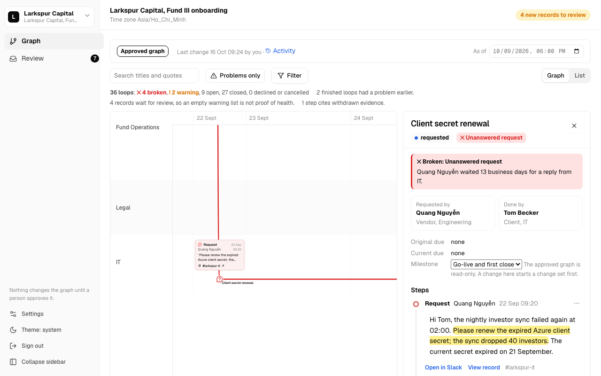
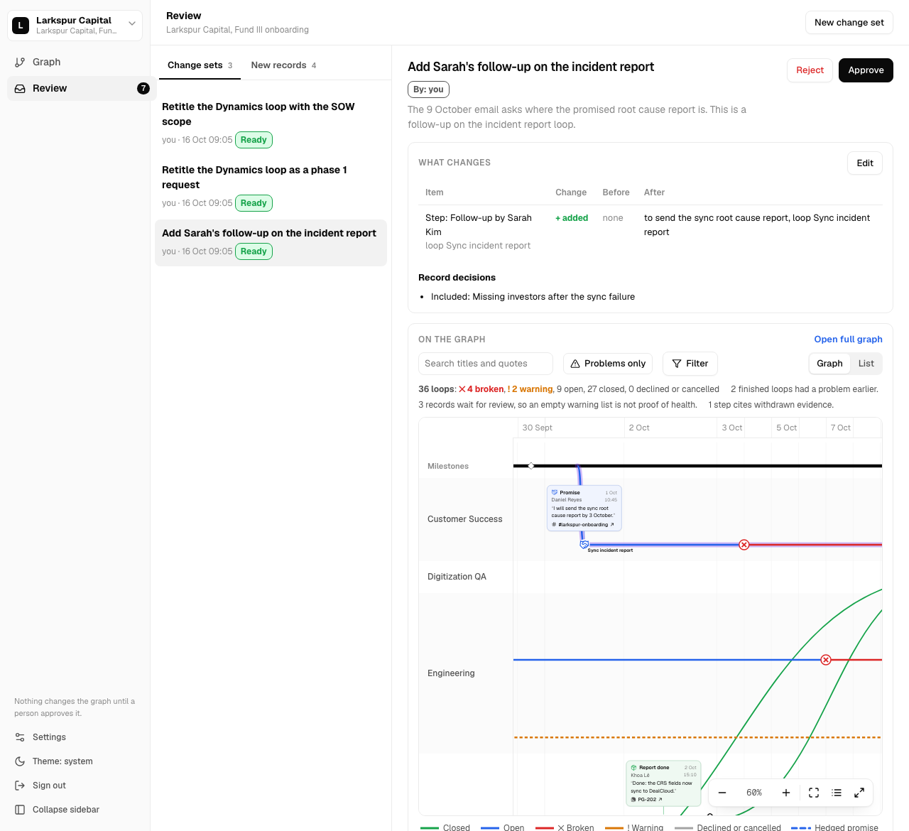

# Promise Graph

Promise Graph shows who asked for what, who committed, what was delivered and where a project stalled. Every line on the graph points to the message that made it.

It is for customer success and implementation managers. They must reconstruct a project history from evidence in chat, email and documents, for example before they answer a customer complaint.

## How it works

- **Evidence store.** Records enter the New records list through paste or MCP import. A record version never changes. An import never changes the graph.
- **Versioned graph.** The graph has a main line, draft proposals, a diff, an explicit merge, history, revert and restore. Each act cites an exact quote with UTF-16 offsets in a record version. The screens call a proposal a "change set" and a merge an "approval". The API and the MCP tools keep their names.
- **Deterministic engine.** A pure function derives loop states and 7 breakdown types (for example `silent_overdue` and `unanswered_request`) from the graph at a time `T`.
- **No AI in the app.** The app and its server call no AI model and hold no provider key. You connect your own agent (for example Claude Code) to `/mcp` with a project token. The agent reads evidence, submits a proposal and reads its diff. A person reviews the proposal and merges it. A default token cannot merge.

## Screenshots

The screenshots come from a local development server on 16 October 2026, with the seeded sandbox.

The approved graph with the loop panel open. The red branch has an `unanswered_request` breakdown, and the panel shows the cited quote in its message:



The Review screen with a change set selected: the change, its effect on the loops, the quotes and the Approve and Reject buttons:



The Settings page: the agent permissions, the MCP client snippet and a created token:


The design file is [docs/design/2026-10-13-promise-graph-ui.html](docs/design/2026-10-13-promise-graph-ui.html). Open it in a browser to see every screen. The requirements are in [docs/superpowers/specs/2026-10-12-promise-graph-srd.md](docs/superpowers/specs/2026-10-12-promise-graph-srd.md).

Your first sign-in creates a private sandbox: a copy of the fictional Larkspur Capital onboarding project with 137 records and 36 reviewed loops ([fixtures/README.md](fixtures/README.md)).

## Connect an agent

1. Open **Settings** in a project and create a token. Copy the secret; the app shows it once.
2. Add the server to your MCP client:

   ```json
   {"mcpServers":{"promise-graph":{"type":"http","url":"https://<host>/mcp","headers":{"Authorization":"Bearer inv_..."}}}}
   ```

3. Follow the recipe in [docs/mcp-agent-recipe.md](docs/mcp-agent-recipe.md): read the project, read pending records, create a proposal, send operations, read the diff.
4. Ask the agent to list its tools. Then press **Check again** in Settings. The **Last call** column of the token shows the time of that call.

## Local setup

Requirements: Node.js 24, Docker. pnpm is not needed globally; the commands use `npx pnpm@11.25.0`.

1. Start PostgreSQL 17 on `127.0.0.1:55432`:

   ```sh
   docker compose up -d postgres
   ```

2. Copy the environment file and set a session secret:

   ```sh
   cp .env.example .env.local
   openssl rand -hex 32   # paste the output into SESSION_SECRET in .env.local
   ```

3. Install the dependencies and apply the migrations:

   ```sh
   npx pnpm@11.25.0 install --frozen-lockfile
   node --env-file=.env.local scripts/migrate.mjs
   ```

4. Start the app and open <http://localhost:3000>. With `AUTH_MODE=local`, **Continue (local dev)** signs you in without Google.

   ```sh
   npx pnpm@11.25.0 dev
   ```

### Environment variables

| Variable | Value |
|---|---|
| `AUTH_MODE` | `google` in production. `local` works only on a loopback origin and only when `NODE_ENV` is not `production`. |
| `NEXT_PUBLIC_APP_URL` | The public origin, for example `https://promise-graph.onrender.com`. Production requires `https`. The server reads it at run time. |
| `SESSION_SECRET` | At least 32 bytes. It signs the session cookie. |
| `GOOGLE_CLIENT_ID`, `GOOGLE_CLIENT_SECRET` | The Google OAuth web client. Required when `AUTH_MODE=google`. |
| `DATABASE_URL` | The PostgreSQL connection URL. |

### Commands

| Command | Purpose |
|---|---|
| `npx pnpm@11.25.0 typecheck` | TypeScript check |
| `npx pnpm@11.25.0 lint` | ESLint |
| `TEST_DATABASE_URL=<admin url> npx pnpm@11.25.0 test` | Unit and integration tests. Each integration file creates and drops its own database. Without `TEST_DATABASE_URL`, the integration tests skip. |
| `npx pnpm@11.25.0 eval` | Offline deterministic evaluation (no network, no model) |
| `npx pnpm@11.25.0 check:providers` | Fails if a model SDK, provider credential or analysis job kind appears |
| `TEST_DATABASE_URL=<admin url> npx pnpm@11.25.0 test:e2e` | Playwright suite against a dev server and a throwaway database |
| `npx pnpm@11.25.0 build` | Production build (Next.js 16, Turbopack, standalone output) |

## Deploy on Render (free plan)

[render.yaml](render.yaml) is a Render Blueprint. It declares one Docker web service (`plan: free`, health check `/api/health`) and one PostgreSQL 17 database (`plan: free`) in the Singapore region. The container applies pending migrations on each start, then starts the server. If a migration fails, the container stops and Render keeps the previous deploy.

The free plan has two limits that affect the demo:

- A free web service sleeps after 15 minutes without traffic. The first request after that waits about one minute.
- A free database expires 30 days after creation. Render deletes it after a further 14 days. A workspace can have only one free database.

Do these steps in this order:

1. **Create the Google OAuth client.** In Google Cloud Console, go to **APIs & Services → Credentials → Create credentials → OAuth client ID**. Select **Web application**. Leave the redirect URI empty for now. Configure the consent screen with the scopes `openid`, `email` and `profile`, and set its publishing status to **In production**. In **Testing** status, only the listed test users can sign in. Keep the client ID and the client secret.
2. **Apply the Blueprint as soon as possible, no later than 15 October.** The free database lives 30 days, so a database created by 15 October stays alive until about 14 November. That date is after 22 October. In the Render dashboard, select **New → Blueprint**, connect this repository and select the branch to deploy. Render reads `render.yaml`.
3. **Enter the prompted values.** Render asks for the three `sync: false` variables:
   - `NEXT_PUBLIC_APP_URL`: `https://<service>.onrender.com`. The service name in `render.yaml` is `promise-graph`. If Render adds a suffix, use the URL that the service page shows, and correct the variable after the first deploy.
   - `GOOGLE_CLIENT_ID` and `GOOGLE_CLIENT_SECRET`: the values from step 1.

   Render generates `SESSION_SECRET` and connects `DATABASE_URL` to the database over its private network. The database accepts no external connections (`ipAllowList: []`).
4. **Add the redirect URI.** In the Google OAuth client, add the authorized redirect URI `https://<service>.onrender.com/api/auth/google/callback`. It must equal `NEXT_PUBLIC_APP_URL` followed by `/api/auth/google/callback`.
5. **Deploy and check.** The service has `autoDeploy: false`, so start each deploy with **Manual Deploy**. Then check:
   - `https://<service>.onrender.com/api/health` returns `{"status":"ok"}`.
   - The deploy log shows `{"event":"migrations_applied",…}`.
   - **Continue with Google** signs you in and shows the seeded Larkspur graph. The first sign-in of each account builds its sandbox, so on the free plan it can take about 10 seconds. If the callback page is reloaded after that, Google refuses the used code and the page shows a **Sign-in expired — start again** link.
6. **Keep the demo awake until 22 October.** Create a free monitor at [UptimeRobot](https://uptimerobot.com) (or a similar service): type HTTP(S), URL `https://<service>.onrender.com/api/health`, interval 10 minutes. One always-on free service uses about 744 of the 750 free instance hours in a 31-day month, so do not run a second free service in the same workspace.
7. **Run the live release walkthrough** (see [Release checks](#release-checks)) with a Google account that has never signed in. Then connect a real agent with the MCP snippet and let it create one proposal. Record the agent, the model and the date in the table under [Measured results](#measured-results).

The app runs as one process because the rate limiter is in memory. Do not scale the service to more than one instance.

## Release checks

The release walkthrough [tests/e2e/release.spec.ts](tests/e2e/release.spec.ts) follows the ten-minute demo (SRD 15.1 items 1, 2, 4–7 and 9) against `BASE_URL`. It uses [playwright.release.config.ts](playwright.release.config.ts) and starts no server.

**Local production image.** Production refuses local sign-in and a non-HTTPS origin. The check therefore runs the image with `AUTH_MODE=google` behind a local TLS proxy. It creates each test user in a throwaway database and signs a session cookie with the container's `SESSION_SECRET`. Only the Google code exchange is skipped; a separate test checks the Google redirect, its `state` and its PKCE challenge.

```sh
docker build -t promise-graph:rc .
# rc.env: DATABASE_URL (throwaway database, host.docker.internal), AUTH_MODE=google,
# NEXT_PUBLIC_APP_URL=https://localhost:3443, SESSION_SECRET, GOOGLE_CLIENT_ID, GOOGLE_CLIENT_SECRET
docker run -d --name pg-rc -p 3001:3000 --env-file rc.env promise-graph:rc
openssl req -x509 -newkey rsa:2048 -nodes -keyout key.pem -out cert.pem -days 2 -subj /CN=localhost -addext subjectAltName=DNS:localhost
node tests/support/tls-proxy.mjs 3443 http://127.0.0.1:3001 key.pem cert.pem &
BASE_URL=https://localhost:3443 RELEASE_INSECURE_TLS=1 \
  RELEASE_DATABASE_URL=<same database, host view> RELEASE_SESSION_SECRET=<same secret> \
  ./node_modules/.bin/playwright test -c playwright.release.config.ts
```

**Timing budgets.** The walkthrough always records the first contentful paint and the graph API p50 and p95. It enforces the SRD 14 budgets (paint under 2 s, p95 under 500 ms) only when `RELEASE_TIMING_BUDGET` is set, for example `RELEASE_TIMING_BUDGET=1`. Leave it unset against the free Render plan, which does not meet these budgets (see [Measured results](#measured-results)).

**Live deployment.** Sign in with Google once and save the session, then run the walkthrough. Each test waits for a new minute so that one user stays under the limit of 20 writes a minute.

```sh
npx playwright codegen --save-storage=live-session.json https://<service>.onrender.com/signin
BASE_URL=https://<service>.onrender.com RELEASE_STORAGE_STATE=live-session.json \
  ./node_modules/.bin/playwright test -c playwright.release.config.ts
```

If Google refuses to sign in inside the codegen browser, sign in with your normal browser, copy the `pg_session` cookie value from the developer tools, and write it into `live-session.json`:

```json
{"cookies":[{"name":"pg_session","value":"<cookie value>","domain":"<service>.onrender.com","path":"/","expires":-1,"httpOnly":true,"secure":true,"sameSite":"Lax"}],"origins":[]}
```

Delete `live-session.json` after the run. It holds a valid session cookie.

## Measured results

Environment: Apple M4 (10 cores), 16 GB RAM, macOS 26.6.2, Docker Desktop 29.5.2. The app ran as the production image (`node:24-alpine`, Turbopack build, `NODE_ENV=production`) on the same machine as PostgreSQL 17.11 and the Playwright Chromium browser. These numbers come from one machine; they are not a benchmark of the free Render plan, which has 0.1 CPU for the database and a shared CPU for the web service.

| Measure | Target (SRD 14) | Result |
|---|---|---|
| Layout of 300 loops and 3,000 acts, median of 5 runs | under 50 ms | 5.91 ms (Node 26.8.2, Apple M4) |
| First contentful paint of the seeded graph (reload, warm server and browser cache) | under 2 s | 76 ms |
| `GET /api/v1/projects/:id/graph` on the seed, 25 sequential calls | p95 under 500 ms | p50 22 ms, p95 40 ms |

**Local approximation of Render Free.** A reviewer ran the same production image in a container limited to 0.1 CPU and 512 MB of memory, with the release walkthrough and `RELEASE_TIMING_BUDGET` unset. This is a local approximation of the free plan, not a measurement on Render:

| Measure | Target (SRD 14) | Result (0.1 CPU, 512 MB, local) |
|---|---|---|
| Container healthy after start, empty database | none | 38 s |
| First contentful paint of the seeded graph | under 2 s | about 7.6 s (misses the target) |
| `GET /api/v1/projects/:id/graph` on the seed | p95 under 500 ms | p50 about 0.8 s, p95 about 3.2 s (misses the target) |

On this budget the first sign-in, which seeds the sandbox, can take about 10 seconds.

Offline evaluation (`pnpm eval`) on the hand-written gold fixtures:

```
transition/breakdown accuracy: 100.0% (36/36)
quote validity: 100.0% (132/132)
expected diff matches: 100.0% (7/7)
conflict detection: 100.0% (6/6)
revert/restore correctness: 100.0% (4/4)
```

These figures measure the deterministic engine and the version control on fixtures. They do not measure AI accuracy.

Live external-agent run (to fill in after step 7 of the deploy):

| Date | Agent | Model | Proposal created | Incorrect links observed |
|---|---|---|---|---|
| not run yet | | | | |

## Known limits

- **Coverage.** The graph covers only imported and reviewed records. Pending records are a coverage limit: the graph header shows how many records wait for review, so an empty warning list is not proof of health.
- **No connectors.** The P1 connectors (Slack events, Slack history, Gmail fetch, scheduled collection) are not built. Records arrive through paste or MCP import only.
- **Free hosting.** The free web service sleeps after 15 minutes without traffic, and the free database expires 30 days after creation. On its 0.1 CPU the graph paints in several seconds and the first sign-in can take about 10 seconds, so the SRD 14 timing budgets hold only on a larger instance. See [Deploy on Render](#deploy-on-render-free-plan) and [Measured results](#measured-results).
- **One instance.** Rate limits (60 reads and 20 writes a minute for each user, 60 calls a minute for each token) are kept in process memory.
