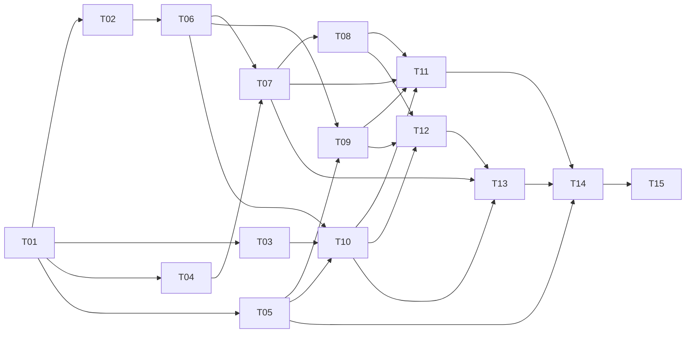

# Promise Graph v1.1: task allocation for coding agents

**Superseded on 13 October after T01:** the [continuation plan](../superpowers/plans/2026-10-13-promise-graph-continuation.md) defines the remaining tasks and their order. This allocation stays as history.

Canonical spec: [SRD v1.1](../superpowers/specs/2026-10-12-promise-graph-srd.md).
Canonical task details, interfaces, files and acceptance tests: [implementation plan](../superpowers/plans/2026-10-12-promise-graph-implementation.md).

This file replaces the old task packet contents. Old task IDs have different meanings; always supply both current documents. Allocation is a proposal for future implementation, not a record of dispatched agents.

## Shared rules

1. Read SRD global decisions/authorization/versioning and the plan constraints before your task.
2. Use an isolated worktree for code and branch `phucluu/<task-id>-<slug>`. Do not reset or overwrite another task’s checkout.
3. Change only owned paths. Integrator coordinates necessary cross-task contract/repository/adapter changes before dependent code continues; routine compatible fixes need no extra user approval.
4. Contracts are defined by T01; schema/migration/repository changes by T06. Never silently fork a type or interpretation.
5. Write meaningful failing acceptance cases before implementation, then verify actual test results. Report files changed, command summary lines/exit codes, acceptance checklist and unresolved questions.
6. Import/suggestion/save/worker completion never moves main. No model SDK, provider keys, AI jobs or implicit merge.
7. Actor identity/project scope comes from verified sessions/tokens. Logs hold IDs/counts only, never source text or credentials.
8. Execute tasks only after assignment. This update is documentation work; agents below have not been started.

## Ownership and dependencies

| Task | Deliverable | Suggested owner | Depends on | Target |
|---|---|---|---|---|
| T01 | Contracts and pure shared helpers | Integrator | — | 12 Oct |
| T02 | Runnable application, identity and deployment | Integrator | T01 | 12–13 Oct |
| T03 | Deterministic loop engine | Engine owner | T01 | 12–13 Oct |
| T04 | Pure graph diff, rebase and inverse | Versioning owner | T01 | 12–13 Oct |
| T05 | Reviewed fictional evidence and graph fixtures | Fixture owner | T01 | 12–13 Oct |
| T06 | Database, immutable ingest and evidence retrieval | Integrator | T01, T02 | 13–14 Oct |
| T07 | Validated proposals, review and atomic merge | Versioning owner | T02, T04, T06 | 14–15 Oct |
| T08 | Rebase, revert and restore transactions | Versioning owner | T04, T07 | 15–16 Oct |
| T09 | Inbox and manual import interface | UI owner | T05, T06 | 14–15 Oct |
| T10 | Graph query, layout and viewing | Engine/UI owner | T03, T05, T06 | 14–16 Oct |
| T11 | Proposal editing, review, conflict and history interface | UI owner | T07, T08, T09, T10 | 15–17 Oct |
| T12 | REST and MCP adapters | Integrator | T02, T06, T07, T08, T09, T10 | 15–17 Oct |
| T13 | Saved complaint analyses and answers | Analysis/UI owner | T07, T10, T12 | 16–17 Oct |
| T14 | Seed, deterministic eval and release verification | Integrator + QA owner | T05, T11, T12, T13 | 17–18 Oct |
| T15 | Optional passive native connectors (P1) | Connector owner | T06, T12, T14 | After P0 gates |

## Practical work lanes

- **Integrator/backend:** T01, T02, T06, T12, then T14. Owns shared contracts/schema and integration; finish those interfaces before parallel dependent work.
- **Versioning/engine:** T04, T07, T08; T03 can be a separate owner once T01 is ready. This is the critical path.
- **UI/fixtures:** T05, T09, T10, T11; T13 follows working domain/adapters. Use fixture data to build displays before backend integration.

These are ownership lanes, not a requirement for three simultaneous agents. With fewer implementers, execute topologically. T03 and T10 can share an engine/UI owner; T13 can join the UI lane after T11. Do not split a task across writers editing the same paths.



## Agent handoff prompt

```text
Implement task <Txx> of Promise Graph v1.1.
Read docs/superpowers/specs/2026-10-12-promise-graph-srd.md and the global
constraints, Review Focus, file map and your task in
docs/superpowers/plans/2026-10-12-promise-graph-implementation.md.
Follow docs/agent-tasks/2026-10-12-promise-graph-tasks.md shared rules.
Implement only your owned paths and consume the frozen T01 contracts.
No application/worker AI calls and no automatic graph placement or merge.
Report changed files, real verification results, acceptance checklist and
unresolved dependencies. Do not start another task without assignment.
```

## Cut order

T15 connectors are entirely optional. Within P0, defer ranked hints, rich answer editing, extra zoom and drag-and-drop if needed. Keep T07/T08 review/versioning correctness and T12 MCP interoperability; otherwise the new product promise is not met.
