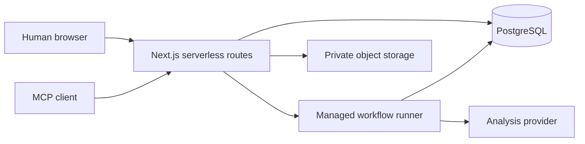
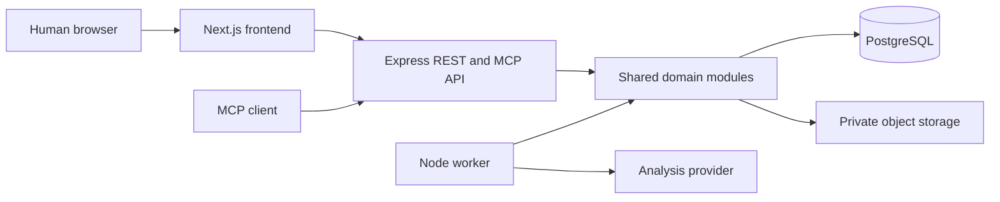
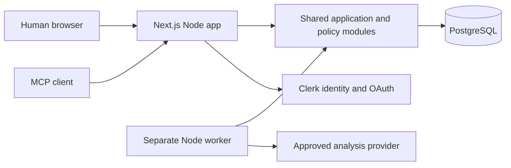
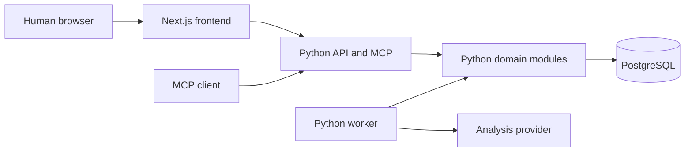
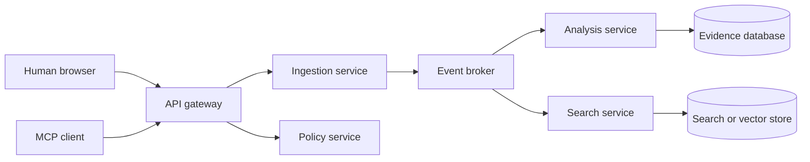
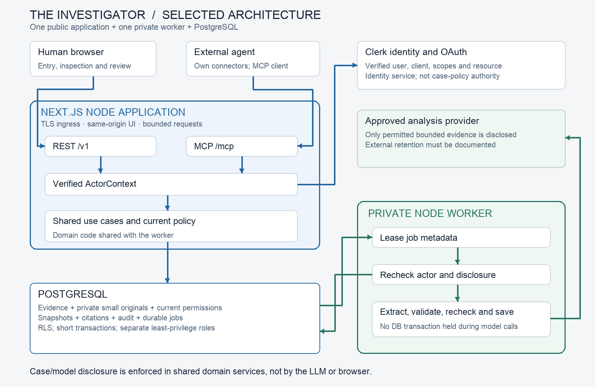
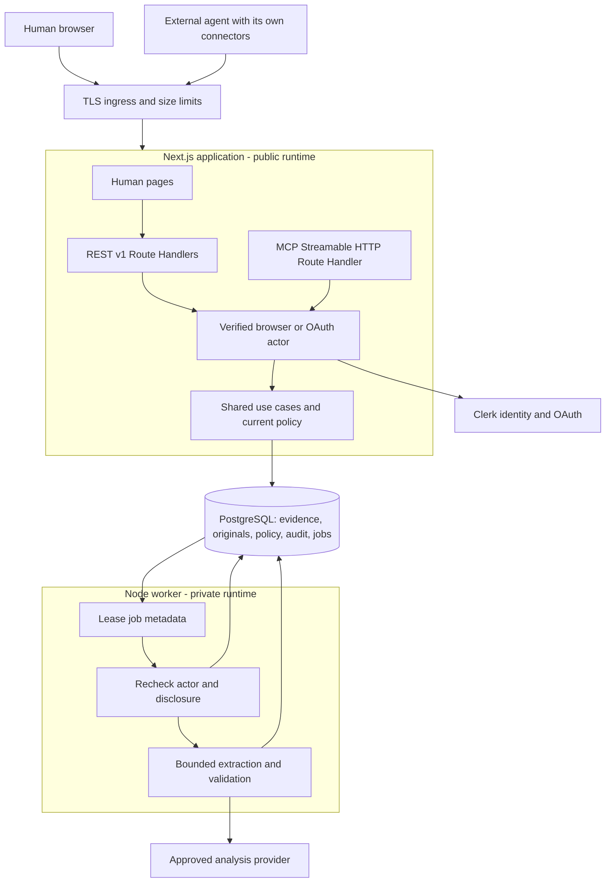
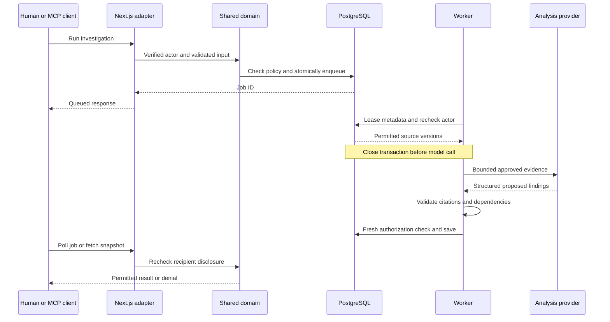
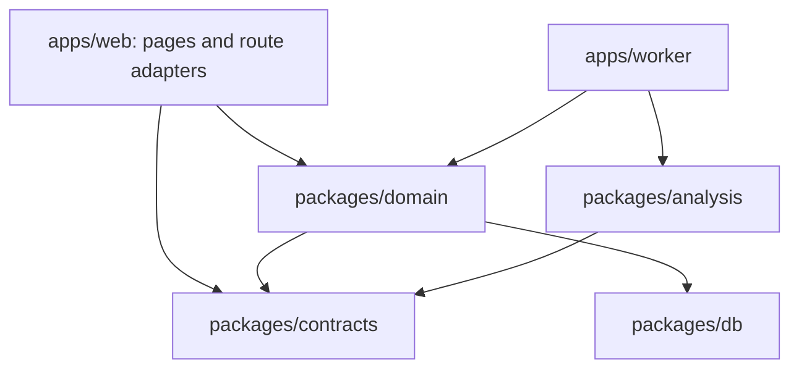

# The Investigator — architecture alternatives and decision

Date: 10 October 2026. Status: selected design for the SRD; implementation and load benchmarks have not started.

## Decision

Choose **a TypeScript modular monolith with a separately deployed worker**: one self-hosted Next.js Node application serves the human website, REST and MCP; a Node worker runs analysis jobs; PostgreSQL stores evidence, private small-file originals, permissions, audit records, full-text indexes and the job queue.

Optimize for delivering and verifying the eight-day MVP. This is not a claim of universal architectural superiority or measured performance. The worker is a second process, not a separate business service: it uses the same domain packages, contracts, schema and release revision.

## Repository evidence and constraints

- The repository currently contains planning documents and Git history; it has no application source, framework, package manifest, deployed service or migration to preserve. TypeScript/Next.js are chosen defaults, not discovered legacy requirements.
- Delivery deadline is 18 October 2026, 23:59 HCMC time. There is no evidence of a large platform team or large initial traffic; use a small-team MVP assumption.
- Three intake paths are mandatory: human entry, file imports and agent ingestion through MCP. Upstream live connectors are deferred; agents can use their own connectors.
- Permission checks and source provenance are more important than horizontal scale. A summary must not expose evidence hidden from its recipient.
- P0 files are TXT/MD/JSON/EML, maximum 5 MiB/upload. A case has at most 200 active records and 256 KiB permitted analysis text. There is no OCR/media workload justifying a specialized processing service.
- Public OAuth-enabled MCP, asynchronous analysis, versioned citations, safe retries and reviewed downloads must work in the live demo.

## Evaluation method

First reject designs that cannot reasonably satisfy current authorization, durable jobs or real MCP interoperability. Then compare operational simplicity and delivery effort. All five candidates can satisfy the functional requirements with sufficient engineering; their security scores reflect the difficulty of implementing consistent controls within eight days, not an inherent guarantee.

Scores are ordinal engineering judgments, 1 = poor fit and 5 = strong fit. The weighted total is a decision aid, not a benchmark. Security release gates remain mandatory regardless of score.

| Criterion | Weight | Why it matters here |
|---|---:|---|
| Eight-day delivery | 25% | The live workflow must be finished and rehearsed |
| Security consistency | 25% | Human, agent and worker must agree on current disclosure policy |
| MCP fit | 15% | Public authenticated Streamable HTTP must be tested early |
| Operational simplicity | 15% | Fewer credentials, runtimes and failure boundaries to deploy/debug |
| Agent implementation boundaries | 10% | Independent modules need clear ownership without network-service overhead |
| Growth path | 10% | Preserve seams for later extraction without building them prematurely |

| Option | Delivery | Security | MCP | Operations | Agent boundaries | Growth | Weighted /5 |
|---|---:|---:|---:|---:|---:|---:|---:|
| A. Serverless Next.js + managed workflow runner | 4 | 4 | 3 | 3 | 4 | 4 | 3.70 |
| B. Next.js + separate Express API + worker | 3 | 4 | 5 | 3 | 5 | 4 | 3.85 |
| **C. Next.js modular monolith + worker** | **5** | **4** | **4** | **5** | **4** | **3** | **4.30** |
| D. Next.js + Python API/worker | 3 | 4 | 4 | 3 | 4 | 4 | 3.60 |
| E. Event-driven microservices | 1 | 2 | 4 | 1 | 4 | 5 | 2.40 |

Scores should be revisited if a candidate has an existing working starter, the implementers have substantially different expertise, or the expected workload changes. Small changes in growth or agent-boundary weights do not reverse the choice; substantially favoring independent service scale could favor B. No unsupported infrastructure cost or throughput numbers are used.

## A. Serverless application with managed workflows

**Advantages:** quick frontend deployment; managed job retries/concurrency can replace custom queue code; good fit for a team already using that workflow provider.

**Costs here:** another provider/account and workflow authorization boundary; some runners retain job payloads unless configured otherwise; route/proxy execution limits and streaming behavior must be verified for MCP. Provider requests do not belong in short-lived routes. A backend-for-frontend framework does not itself provide durable background execution.

**Decision:** not selected because we have no existing managed-workflow setup. It is viable, not fundamentally insecure. It becomes attractive when an approved workflow platform already exists and its data-handling controls are established.

## B. Frontend, dedicated API and worker

**Advantages:** clean independent API lifecycle; direct Node/Express MCP integration; frontend can scale/deploy independently; shared domain code can still ensure policy consistency. Strong choice for a backend-centric product with multiple clients or an existing API team.

**Costs here:** three application processes instead of two, additional frontend/API token forwarding or cross-origin configuration, extra deployment health/configuration, and separate storage credentials. Physical separation does not automatically improve authorization: both adapters still need a correct shared policy layer. We have no separate API to preserve.

**Decision:** credible runner-up, but the extra API runtime does not buy enough for this MVP. If route-handler MCP compatibility fails the day-1 gate, B is the documented fallback; an explicit ADR/SRD update is required, not an agent's silent substitution.

## C. Modular monolith with worker — selected

**Advantages:** same-origin human UI and REST; one public application deployment exposes both interfaces; schema/types/policy are shared directly; jobs survive web-process restarts; no browser-to-separate-backend identity forwarding; module ownership still supports different agents.

**Costs:** Next.js deployment and MCP must coexist; shared web/API process means a web-process failure interrupts both; modules share a runtime and must enforce import boundaries; originals in PostgreSQL consume database storage/backups. Keep the worker independent because model calls can outlive a web request and have different concurrency/secret needs.

**Decision:** selected for the best delivery-to-verification ratio under the actual repository constraints. Official Next.js documentation supports Node/Docker hosting and Route Handlers, and Clerk documents MCP integration with Next.js. This establishes a supported path, not proof that our chosen SDK/client versions interoperate; the day-1 live OAuth spike remains mandatory. [Next.js Route Handlers](https://nextjs.org/docs/app/api-reference/file-conventions/route), [self-hosting](https://nextjs.org/docs/app/guides/self-hosting), [Clerk Next.js MCP integration](https://clerk.com/docs/nextjs/guides/ai/mcp/build-mcp-server)

## D. Python investigation backend

**Advantages:** useful ecosystem for OCR, document analysis and evaluation; natural choice if the team already has Python domain code or a Python service.

**Costs here:** separate TypeScript/Python schema generation and validation, two packaging/runtime ecosystems, another deployment process, and no P0 task requiring Python-specific libraries. Semantic extraction is an external provider call, not a local ML pipeline.

**Decision:** not selected. Reconsider for specialized document/OCR workers, which can later consume stable job contracts without rewriting the human/MCP surfaces.

## E. Event-driven microservices and separate search stores

**Advantages:** independent scaling and release domains; fits a mature organization with ownership and infrastructure for separate services.

**Costs here:** distributed policy/cache invalidation, event schemas and replay, multiple secrets/stores, eventually consistent withdrawal, tracing and duplicate-message handling. Versioned evidence and metadata audit do not require full event sourcing. Eventual consistency creates additional work proving immediate disclosure denial.

**Decision:** reject for P0. Logical module boundaries provide agent parallelism without distributed security state. A later extraction must follow measured pressure, not a hypothetical traffic forecast.

## Selected design: concrete components and trust boundaries

There are two application deployables, one database and two external trust dependencies: identity provider and analysis provider. TLS ingress is supplied by the chosen hosting platform or reverse proxy; it is not another custom business service. Do not bundle analysis provider credentials into the web container.

### Component decisions and reasons

| Decision | Reason | Tradeoff / proof required |
|---|---|---|
| TypeScript throughout | One set of schemas/types across UI, REST, MCP and worker; no existing Python service to reuse | Agent familiarity is assumed; validate runtime inputs with Zod rather than relying on types |
| Next.js Node Route Handlers | Human UI and public adapters deploy together; provider-supported MCP integration path | Pin/test adapter versions; no Edge runtime for DB/parsing/MCP; no custom Express server |
| Separate worker | Durable long model tasks, independent concurrency and provider secret | Second process to operate; same release revision as app |
| Clerk identity/OAuth | Avoid building an authorization server; documented Next.js MCP integration | Account configuration/client/scopes may affect availability; prove verified client/resource binding early |
| Shared domain policy | One behavior for people and agents; thin adapters | Enforce package/import boundaries and policy tests; module sharing alone is not security |
| PostgreSQL + Drizzle | Transactions, composite tenant keys, RLS, evidence joins and queue state in one store; explicit migrations | Migration/RLS review required; no browser database access |
| PostgreSQL job leases | Job insertion and business state commit together; no Redis/broker consistency problem | Bounded workload only; explicit claim function, retry/concurrency tests |
| Small originals in private bytea rows | 5 MiB maximum files can share transactional authorization/retention with records; removes P0 bucket credentials and orphan-object handling | Database/storage/backups grow; strict quota and no bytes in routine queries |
| PostgreSQL full-text search | Enough for bounded case evidence; policy joins happen in the same query | Recall can be weaker than semantic search; analyze all permitted bounded case text, not search hits alone |
| Structured LLM extraction | Useful reasoning without allowing the model to perform arbitrary actions | Exact citations and dependency tracking plus human review; schema validity does not prove truth |
| No shared evidence-result cache in P0 | Avoid policy-invalidation leakage across users/clients | More reads; acceptable only subject to actual p95 testing |
| Stateless MCP request processing | Avoid shared mutable user state and extra session store | Verify chosen client/tool features; no resumable event stream promised |

PostgreSQL documents binary storage through bytea, and SKIP LOCKED as useful for queue-like consumers. Those capabilities support this design; our quota/lease choices still require tests. [Binary types](https://www.postgresql.org/docs/current/datatype-binary.html), [SELECT locking](https://www.postgresql.org/docs/current/sql-select.html)

## Storage, queue and request details

### Private originals

Add `evidence_files` rows with tenant_id, case_id, file_id, MIME type, byte size, digest, original bytes and purge state. No signed/public URLs; access only through authorized application routes. Large bytes are stored in a separate table so search/list queries cannot accidentally select them.

Apply the existing 5 MiB/upload limit plus a P0 **100 MiB stored-content quota per case**, including staged/committed originals, normalized text and historical versions. Quota updates lock the case storage counter and commit atomically with import. Exhaustion fails explicitly before accepting committed content; never silently drop originals. Expired staging releases quota; quota reclamation occurs when bytes are actually purged. Reject an upload over 5 MiB while reading its stream, not after allocating an unbounded buffer.

Two hundred maximum-size normalized records are roughly 12.5 MiB before versions/raw files, so 100 MiB provides bounded headroom for the fictional MVP, not a forecast of production needs. Raw/normalized copies are intentional for provenance. Backup retention is separately disclosed; live-store purge cannot promise erasure from provider backups within 24 hours.

### Durable jobs

Job enqueue and snapshot/brief request bookkeeping commit in one database transaction. Queue rows contain opaque IDs, type, principal references, source/version references, case/policy revisions, lease and status; no duplicated source bodies or credentials.

A narrow queue-claimer role can execute a hardened database claim function returning lease metadata across tenants. It has no direct evidence/body access. The function has a fixed search_path, no dynamic SQL, no public EXECUTE and only necessary queue privileges; it atomically leases a row with SKIP LOCKED, serializes the tenant concurrency check through a per-tenant scheduler row lock, and increments a lease generation/token. Every heartbeat, completion, retry/failure transition and artifact-save transaction compares that token; an expired/replaced worker cannot mutate the job or publish a result. Do not infer a two-job limit from row-level SKIP LOCKED alone. The worker then uses the normal non-bypass RLS role in short actor-scoped transactions. Queue discovery never grants evidence rights.

Read and authorize permitted evidence in a short transaction; close it before model network calls. Recheck permissions/dependencies in a fresh transaction before saving results. Do not hold row locks or database connections for the duration of model inference. Revocation after a provider already received a payload cannot recall it; the audit records what was disclosed.

### Human and MCP requests

Routes are `/v1/...` and `/mcp` on the same origin. Implement Node Route Handlers and centralized request/error/limit helpers. No public mutation through Server Actions in P0; one visible REST/MCP-to-domain path simplifies review. If a server-rendered page calls a use case directly, it must build the same verified ActorContext and use the same policy, never an unrestricted repository.

Browser writes require origin/CSRF checks appropriate to cookie authentication; MCP uses verified bearer OAuth identity and registered audience/resource semantics. MCP Origin handling does not replace bearer authorization. Protected data responses set `Cache-Control: private, no-store`; no static generation, CDN caching or cross-principal React data cache for evidence or artifacts. Public static assets may be cached.

## Job execution drawing

## Package boundaries for agent implementation

Frontend browser modules can import contracts, never domain/db/analysis. Node adapters can import domain and contracts, never issue unrestricted queries. Domain defines the AnalysisProvider port and receives implementations through worker composition; it does not import vendor SDKs or depend on Next.js. The analysis package implements that port without importing repositories or making permission decisions. A type-only port can live in contracts to avoid cyclic imports.

Keep business modules for security, cases, ingestion, evidence, investigations, briefs, jobs and audit. Different agents own those modules and specific route directories. They do not need separate network services to work independently. Database migrations and contracts retain one integrator owner.

## Early proof and fallback rules

By 11 October demonstrate on the chosen deployed Node host:

1. Browser login and isolated fictional case access.
2. Real MCP OAuth consent, verified subject/client/scopes/resource, tool discovery and one scoped read.
3. 5 MiB upload enforcement and no public original access.
4. Durable job survives a web restart and worker crash; duplicate execution yields one artifact.
5. Non-bypass RLS role and concurrent tenant transactions remain isolated.

If OAuth/Next adapter interoperability cannot be demonstrated after the bounded spike, use the separate Express API option only after recording the failed capability and updating the SRD/plan explicitly. Do not weaken authentication, fabricate interoperability or add a custom OAuth server to rescue the demo. Provider account setup is an external dependency, not solved by architecture alone.

## Growth path and evidence that justifies a change

| Observed pressure | Next change | Why this seam is preserved |
|---|---|---|
| Larger files/media or database backups dominated by originals | Move evidence_files bytes behind a private object-storage adapter | IDs/provenance and domain authorization stay stable |
| MCP traffic/lifecycle needs diverge from web deployment | Extract REST/MCP adapters into a Node API | Framework-free domain and wire contracts already exist |
| Job claim latency/retries exceed tested limits | Adopt a mature queue/workflow engine with metadata-only payloads | Leased job domain contract does not expose provider details |
| Retrieval evaluation shows poor full-text recall | Add pgvector/hybrid retrieval under identical policy joins | Evidence IDs and current disclosure checks remain canonical |
| OCR/large document extraction becomes required | Add a specialized worker | Source-version/citation contracts remain unchanged |
| Large multi-team release ownership is established | Extract a specific bounded business module | Logical boundaries exist; distributed policy consistency must be designed first |

Do not claim these pressure thresholds have been measured. Release testing records current latency, memory, queue behavior and database size; future changes follow those measurements.

## Impact on repository documents

- SRD §7 contains only this chosen architecture and its implementation rules; all alternatives remain here.
- Implementation plan uses `apps/web/src/server/{auth,rest,mcp}` plus Route Handlers and `apps/worker`; no `apps/api`, Express composition or P0 object-store credentials.
- Agent assignments preserve the eight task responsibilities with updated paths/storage. Authentication, source-policy and provenance requirements remain mandatory.
- This decision changes deployment structure, not the agreed input methods or confidentiality model.

## Sources

Capabilities above were checked against primary documentation on 10 October 2026. Detailed recommendations are engineering judgments derived from the repo constraints.

- [Next.js Route Handlers](https://nextjs.org/docs/app/api-reference/file-conventions/route)
- [Next.js self-hosting](https://nextjs.org/docs/app/guides/self-hosting)
- [Docker Next.js standalone deployment](https://docs.docker.com/guides/nextjs/)
- [Clerk Next.js MCP integration](https://clerk.com/docs/nextjs/guides/ai/mcp/build-mcp-server)
- [PostgreSQL row security](https://www.postgresql.org/docs/current/ddl-rowsecurity.html)
- [PostgreSQL binary types](https://www.postgresql.org/docs/current/datatype-binary.html)
- [PostgreSQL SELECT and SKIP LOCKED](https://www.postgresql.org/docs/current/sql-select.html)
- [MCP authorization](https://modelcontextprotocol.io/specification/latest/basic/authorization)
