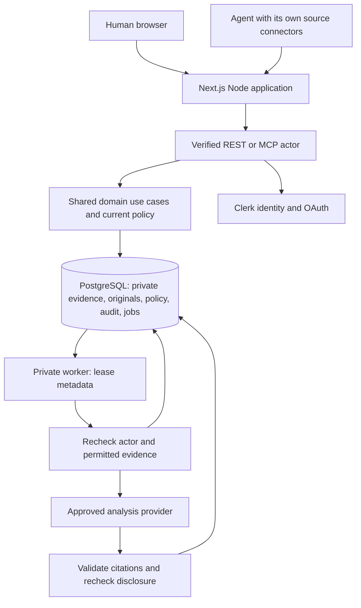

# The Investigator — Software Requirements Document

Status: Draft for product review; implementation is not yet authorized.
Version: 0.2 | Date: 10 October 2026 | Delivery deadline: 18 October 2026, 23:59 Asia/Ho_Chi_Minh.

## 1. Intent and product decisions

Build a secure evidence desk that reconstructs a client implementation escalation from tickets, email, chat, documents, and personal accounts. Humans use a website; agents use an MCP server. Both interfaces use the same evidence, permissions, investigation service, and audit history.

Product promise: **Understand what happened, prove what you know, and identify what remains unanswered.**

Agreed direction: humans may enter evidence or import files; agents with their own connectors may submit evidence through MCP. Users do not need to retype source histories, and the application need not implement every upstream connector.

Proposed defaults in this document are builder recommendations, not previously approved user decisions: TypeScript stack, authentication provider, file formats, role model, numeric limits, deployment, and precise tool contracts.

Primary user: a client implementation investigator responding to a disputed deadline, changing scope, or a failed integration. Anduin's public implementation context inspires the fictional scenarios; this is not a claim about its internal tools or processes.

## 2. Success and scope

### Release gates

- A signed-in human can create a case, add evidence, build an investigation, challenge a claim, and download a reviewed brief.
- An authenticated MCP client can stage and commit evidence gathered through its own connectors, then query the same case and citations visible in the website.
- Automated tests prove isolation across tenants, cases, restricted evidence, and model disclosure boundaries.
- Three fictional cases demonstrate contradictions, changed commitments, missing evidence, and a new import changing an assessment.
- Judges can open a live application and inspect a public repository. No private organizational data appears in fixtures or the public demo.
- A real MCP client demonstrates ingestion and investigation; an SDK integration test alone does not prove client interoperability.

### P0: mandatory eight-day MVP

Authentication; tenant/case access; manual evidence entry; TXT/MD/JSON/EML imports; MCP batch ingestion; provenance and version history; timeline; commitments; claim assessment; internal and client-facing draft briefs; audience review; audit history; deployment and adversarial fixtures.

### P1: only after all P0 release gates pass

Side-by-side snapshot replay, semantic retrieval, richer commitment visualization, source-connector adapters, PDF/DOCX extraction, signed evidence packages, additional MCP client interoperability.

### Out of scope

Live Slack/Jira/mail synchronization, arbitrary URL fetching, email sending, source deletion, automated blame assignment, legal determinations, forensic authenticity certification, complete enterprise DLP, production compliance certification, and guaranteed prompt-injection immunity.

## 3. Actors and permissions

Tenant membership is stored locally and mapped from verified identity-provider subjects. The browser never chooses its identity through request fields.

| Actor | Allowed actions |
|---|---|
| Tenant admin | Create cases, manage case memberships and MCP grants; no automatic restricted-evidence access |
| Case owner | Read permitted evidence; ingest; investigate; classify evidence; review/download briefs; manage this case |
| Investigator | Read permitted evidence; ingest; investigate; create briefs and notes |
| Viewer | Read permitted evidence and investigation outputs; cannot mutate or initiate model processing |
| MCP client | Intersection of its user's current case rights, OAuth scopes, and active per-client case grant |
| Background worker | Process only the evidence authorized for the enqueuing actor and configured model route |

Case membership contains `can_read_restricted: boolean`, default false. Even an owner/admin needs this permission to read restricted evidence. Only an owner with this permission can change restricted classification; tenant admins can administer membership without reading evidence. In P0 a tenant admin may explicitly grant or revoke this flag for any case member, including themselves, through a human-only audited action. A case owner who is not a tenant admin cannot change this flag. Case creation does not grant it. This is an administratively controlled boundary, not a cryptographic boundary against tenant administrators; demonstrate the distinction in settings and audit history.

Evidence has `classification: standard | restricted`, `client_shareable: boolean` (default false), and `model_policy: human_only | analysis_allowed | agent_export_allowed`.

- `human_only`: never send source content to a model, including the application's model provider.
- `analysis_allowed`: may reach the configured, case-approved analysis provider; never external MCP clients.
- `agent_export_allowed`: permits both analysis and approved MCP-client disclosure, subject to all other permissions.
- Default for newly submitted evidence: `human_only`. A human case owner explicitly enables broader processing for selected evidence. Agent submissions cannot relax policy; optional stricter classification is accepted.
- A case owner configures the allowed analysis provider route and approves client grants. Restricted sources remain human-only in P0.
- Case grants bind user, tenant, OAuth client ID, case, scopes, expiry, and active/revoked status. No tenant-wide MCP grants in P0.
- Scopes: `cases:read`, `evidence:ingest`, `investigations:run`, `briefs:draft`. Scopes alone do not grant case access.

## 4. Human workflows

### W1: create and populate a case

Create a case with title, description, and optional incident date range. Add a human account, paste a source excerpt, or upload supported files. Preview parsed items, timestamps, provenance, duplicate decisions, and policy defaults. Confirm import. Add selected sources to the case's model-processing allowance through an explicit owner action.

### W2: agent-assisted collection

The user authorizes an MCP client for one case. The client retrieves relevant records with its own upstream connectors, stages them, previews the batch, and commits within its grant. Imported source claims are labeled agent-submitted and unverified. The website shows who imported each item and the batch receipt. An owner decides which imported evidence may enter analysis or subsequent agent disclosure.

The product's authorization begins at its own boundary. It cannot verify that an external agent had upstream permission simply because that agent supplies a source URL.

### W3: investigate and challenge

Select Analyze. A background job creates a snapshot from permitted evidence. Browse timeline, commitment trail, claims, counterevidence, and unanswered questions. Select a claim to open source passages or request reassessment. Add human-only annotations without altering original evidence.

### W4: prepare a response

Generate an internal or client-facing brief from the evidence permitted for that audience. Review its content and citations. A human owner approves an exact brief version for download. Any edit or source/policy change invalidates approval. P0 never publishes or sends a response.

## 5. Functional requirements and acceptance criteria

| ID | Requirement | Acceptance criterion |
|---|---|---|
| AUTH-01 | Browser login and remote MCP OAuth authentication | Invalid, expired, wrong-issuer or wrong-resource tokens receive 401; identities are derived from verified credentials |
| AUTH-02 | Enforce case and evidence authorization on every interface | Knowing another case/evidence UUID cannot retrieve its title, contents, counts, citations, or download |
| CASE-01 | Create, list and inspect authorized cases | Tenant-scoped list with opaque cursor pagination; create records an audit event |
| ING-01 | Human entry distinguishes source excerpt, recollection, and interpretation | Recollections remain labeled and never become verified source records automatically |
| ING-02 | Import TXT, MD, JSON and EML without executable processing | Preview shows records and errors; unsupported/encrypted archives or malformed files fail explicitly; EML HTML is converted to inert text |
| ING-03 | Agent ingestion uses stage → preview → commit | Staging creates no searchable evidence; commit produces stable IDs and a receipt |
| ING-04 | Retry-safe batches and deduplication | Identical retry returns the same receipt; existing records are reused; changed content creates a source version |
| ING-05 | Preserve supplied provenance separately from verified submitter | Agent cannot forge application actor, ingest time, verification status, tenant, or permissions |
| ING-06 | Associate evidence with a selected authorized case | P0 requires explicit case selection; no silent cross-case AI association |
| EVD-01 | Originals are versioned and citations resolve exact passages | Citation opens exact stored version and offsets; correction creates a new version |
| EVD-02 | Owner can withdraw evidence without erasing audit provenance | Withdrawn contents disappear from search/model outputs; dependent snapshots/briefs become stale and non-disclosable |
| EVD-03 | Represent collection coverage honestly | Per-case source declarations show source, date coverage, last import, and incomplete/unknown status; import does not claim continuous sync |
| INV-01 | Timeline separates event time from record and import time | Date-only timestamps retain their precision; missing dates appear in an undated group |
| INV-02 | Identify commitments and changes | Commitment has who, to whom, action, due date if known, status, and evidence links; inferred acknowledgment is labeled |
| INV-03 | Assess claims with supporting/contrary evidence and gaps | Each assessment is supported/contested/insufficient, with citation IDs and explicit unresolved questions |
| INV-04 | Preserve investigation snapshots | New analysis creates a snapshot; earlier outputs remain versioned but obey current access and withdrawal policy |
| INV-05 | Preserve notes separately from source evidence | Notes record actor and origin human/model; P0 notes are private human-only annotations and never analysis/brief input |
| INV-06 | Reject invented citations and unsupported certainty | Unknown/out-of-range citation references fail validation; missing corroboration remains explicit; citation validity is not presented as proof of semantic truth |
| BRF-01 | Generate separate internal/client drafts | Client draft uses only client-shareable evidence from the outset; it never starts from an unrestricted summary |
| BRF-02 | Review exact brief versions before download | Owner review binds version/content hash and dependency revision; changes invalidate approval; MCP cannot approve or download in P0 |
| MCP-01 | Expose structured ingestion and investigation tools | Tools have validated input/output schemas and share application services, error codes, pagination, and authorization |
| MCP-02 | Return bounded permitted evidence | Only `agent_export_allowed` source passages and derived outputs whose complete dependencies permit export reach the client |
| MCP-03 | Explain usable coverage without revealing hidden material | Caller sees permitted source coverage and a general incompleteness disclaimer; no hidden-source IDs/counts/titles |
| AUD-01 | Audit data access and mutations | Actor, client ID if any, case, action, target IDs, request ID, result and timestamp recorded; tokens/bodies are absent |
| UX-01 | Human workflow provides clear async and error states | Imports/analysis show queued/running/succeeded/failed; denied/failed work never appears successful |
| OPS-01 | Deploy web, API/MCP, worker and database | Fresh environment can migrate, seed fictional data, and pass smoke tests using documented commands |

## 6. Ingestion and provenance contract

`EvidenceInput` fields:

```typescript
type EvidenceInput = {
  clientRecordId: string; // 1–128 characters; unique within batch
  sourceType: 'jira' | 'slack' | 'email' | 'document' | 'human';
  sourceInstance: string; // workspace/site/mailbox label; no credentials
  externalId?: string;
  sourceUrl?: string; // https only, stored as reference; never fetched
  title: string; // 1–200 characters
  bodyText: string; // 1–65,536 UTF-8 bytes
  authorLabel?: string;
  sourceCreatedAt?: string; // ISO 8601 with offset
  sourceUpdatedAt?: string;
  eventDate?: string; // YYYY-MM-DD, if date-only
  contentKind: 'original_record' | 'excerpt' | 'recollection' | 'interpretation';
  requestedClassification?: 'standard' | 'restricted';
};
```

Server supplies evidence UUID, source version, actual submitter, verified client ID, importedAt, SHA-256 digest, provenance `human_submitted | file_imported | agent_submitted`, and verification status `unverified`. Direct-source verification is P1. Importers cannot set broader model/client sharing policy.

Canonical source key = tenant + case + sourceType + sourceInstance + externalId. Without externalId, deduplicate by case + contentKind + normalized text digest. Normalization changes CRLF to LF and Unicode to NFC; preserve original bytes/text separately. Identical canonical source + digest reuses a version; changed digest creates a version without overwriting history. There is no cross-case deduplication or version sharing in P0: identical sources imported into two cases are separate stored records. Preview decisions use only the selected case, preventing a submitted external identity from revealing or mutating another case's history.

Within one case, case_evidence links one exact immutable evidence version. A new version supersedes the old active link for new analysis; old versions remain available for permitted historical citations. Imports never change a different case. Withdrawal applies to the selected case/source and all its versions; purge removes only that case's content. Re-importing withdrawn content requires an explicit owner restore action outside P0, so normal import returns CONFLICT rather than silently restoring it.

Canonical identity is a supplied claim, not authority to replace evidence. On a canonical collision, preview and commit both require current source visibility for the submitting interface: human_read for browser/file imports, agent_export for MCP. If unavailable, return generic NOT_FOUND for that item without prior IDs, titles, counts, duplicate/new_version decisions or history; use the same response as any unavailable import target. No supersession occurs. Exact retries of a previously authorized committed batch may return its receipt IDs under a still-valid ingest grant, but may not return source text or new metadata. This is an idempotency receipt, not source-read permission.

New versions inherit existing classification or a stricter requested classification, and reset model_policy to human_only and client_shareable to false. They never automatically inherit broader processing/sharing; an owner explicitly re-approves the new content. Hidden-source matching cannot lower restrictions. For MCP agents this intentionally means updating an earlier source may require owner permission for source visibility first. Authorization, inheritance and canonical lookup are rechecked within the commit transaction, including policy changes after preview.

Batch states: `staged → committed | abandoned`. Batch immutable after commit; expires after 24 hours. Maximum 100 records/batch, 25 records/call, 1 MiB/request, 5 MiB/upload, and 5 MiB total staged text/batch. A parsing error prevents that file from committing; other files can form separate batches. EML attachments are excluded with a visible coverage warning.

Commit transaction checks current actor membership/grant, batch ownership, expiry, and preview revision. Input `expectedRevision` and `idempotencyKey` required. Same key + same request returns existing receipt; same key + different request returns CONFLICT. Race-safe unique keys and row locks prevent duplicate evidence/commits. Unauthorized references use NOT_FOUND without existence details.

## 7. Chosen architecture

### Decision and rationale

Use a **TypeScript modular monolith with a separately deployed worker**. One self-hosted Next.js Node application serves the website, REST `/v1` and MCP `/mcp`; a private Node worker handles analysis; PostgreSQL holds evidence, private small-file originals, policy, search, audit and durable jobs.

The repo has planning documents but no application/framework to preserve. For the eight-day MVP, this architecture reduces deployments, identity forwarding and storage credentials while retaining independent long-job execution. Shared domain modules enforce the same policy for both interfaces; physical co-location is not itself a security guarantee. This is a fit-for-scope decision, not a throughput/cost benchmark.

### Selected components and reasons

| Component | Chosen implementation | Reason |
|---|---|---|
| Human surface and public adapters | Next.js/React, Node Route Handlers, self-hosted standalone container | Same-origin browser REST and a documented Next.js MCP integration path; one public deployment |
| Identity and OAuth | Clerk browser/OAuth verification and MCP discovery integration | Avoid building an authorization server; prove user/client/scopes/resource binding in the early spike |
| MCP transport | Streamable HTTP through a pinned Next-compatible adapter using official MCP SDK schemas | Purpose-built tools, structured outputs and request-scoped identity; adapter compatibility tested with a real client |
| Business logic | Framework-free packages/domain with injected repositories/provider ports | One policy/use-case implementation for browser, MCP and worker; module ownership supports agent work |
| Contracts | TypeScript + Zod in packages/contracts | Shared compile-time types and runtime validation; adapters cannot invent wire formats |
| Data and migrations | PostgreSQL + Drizzle | Transactional imports/revisions/queue state and relational permission joins; tenant RLS defense in depth |
| Originals | Private PostgreSQL evidence_files bytea rows | Bounded 5 MiB uploads fit a simple transactional path; no public buckets, orphan objects or P0 storage credentials |
| Retrieval | PostgreSQL full-text search with authorized joins | Bounded case scope; one canonical policy-aware store; no separate index invalidation boundary |
| Durable work | Separate Node worker using PostgreSQL job leases | Survives web restart and keeps model calls out of requests; same release/contracts/domain packages |
| Analysis | Provider-neutral structured extraction/aggregation and deterministic test adapter | Evidence reasoning with validated citations/dependencies; provider credentials exist only in worker |
| Deployment | One public app container, one private worker container, managed PostgreSQL | Two application deployables with clear failure and secret boundaries; TLS ingress supplied by host/proxy |

No Express/custom Next server, Redis, vector database, managed workflow runner, P0 object-store dependency, or direct browser database access is required. Domain and contracts must not depend on Next.js or vendor model SDKs. Adapters call domain services rather than issuing unrestricted queries; worker composition injects the analysis provider.




### Storage and execution rules

- Originals live in evidence_files, separated from routine list/search tables. Download through authorized application routes only. Preserve bytes, MIME type, size and digest; there are no public/signed blob URLs in P0.
- Maximum 100 MiB stored content per case, counting staged/committed originals, normalized text and history. Enforce the counter transactionally; reject over quota explicitly. Reclaim quota after actual deletion, including expired staged batches.
- Business requests enqueue jobs in the same database transaction as request bookkeeping. Job metadata contains IDs, principal references, revisions and leases, not source bodies or credentials.
- A least-privilege queue-claimer role may execute one hardened, fixed-search-path claim function to lease metadata across tenants; it cannot read evidence. Revoke public EXECUTE, forbid dynamic SQL and direct evidence privileges. Atomically lease with SKIP LOCKED, serialize the tenant concurrency check using a per-tenant scheduler row lock, and issue a unique lease generation/token. Require the current token on heartbeat, completion, failure/retry transitions and artifact-save transactions; an expired worker cannot overwrite a replacement worker or publish results. SKIP LOCKED alone does not enforce the tenant concurrency limit. Worker evidence access uses the normal non-bypass RLS role and reconstructed actor context.
- Use short transactions to load authorized evidence and to save/recheck output. Close database transactions before model network calls; never keep a row lock/connection open throughout inference.
- Authenticated evidence/artifact responses use private, no-store caching; no static generation or cross-user server/CDN caching for protected content. Public assets may be cached.
- Browser cookie-authenticated mutations enforce Origin/CSRF protections. MCP uses verified bearer identity and applicable transport Origin/host checks. Neither middleware nor model instructions replace domain authorization.
- Pin/test framework, SDK and auth adapter versions in Task 0. Node runtime only for database, upload parsing and MCP routes. All public mutations use the REST/MCP domain path; no Server Action mutation path in P0.
- Validate live OAuth/client interoperability and durable jobs by 11 October. If a capability fails, document and review an explicit architecture change; never silently weaken authentication to finish deployment.

### Security boundary

Identity-provider subject maps to local user. MCP OAuth client ID is verified by provider token verification; never read from caller-controlled fields. Server derives current tenant from local membership and resource lookup, not from trusted request parameters. Ingress authentication and per-action checks are independent.

Use PostgreSQL RLS for tenant isolation as defense in depth. Runtime role must not be superuser, table owner, or BYPASSRLS. Set tenant/user context with transaction-local settings using parameter-safe `set_config`; never connection-global settings. Domain policy handles case membership, classification and disclosure. Every request/job has its own transaction/context; concurrent requests cannot share tenant state. Cross-tenant access for admin provisioning uses a separate controlled path.

Analysis is the intersection of current actor read permission and model policy. MCP analysis further restricts inputs to sources exportable to that client, so it cannot induce a summary of hidden sources. Background jobs retain enqueuing actor/client identity, allowed source IDs, case revision and purpose, not user tokens. Recheck before provider call and before saving/releasing output. If permissions change, stop or invalidate the output. Already transmitted data cannot be recalled; disclose this limitation.

Derived events, claims and briefs store complete source-version dependency sets. In P0, conservatively assign the entire model input evidence set as dependencies to every generated artifact, in addition to cited passages. This prevents uncited influence from evading access checks. A single inaccessible dependency denies that derived artifact; regenerate from a permitted subset rather than redact an unsafe summary. Responses disclose no denied dependency metadata.

Search indexes are joined through allowed case evidence before ranking/counts. Cache keys include tenant, user/client, audience and policy revision; P0 may omit result caching. Maintain caseRevision for evidence/content changes and policyRevision for access/disclosure changes. New imports or superseding versions make historical snapshots outdated but viewable if all dependencies remain permitted; they invalidate existing brief approvals. Withdrawal or loss of dependency access blocks disclosure of affected artifacts. Policy changes trigger current dependency checks and invalidate approvals, even if the content remains viewable.

Jobs recheck current permissions before provider calls and saving. If a new import arrives during analysis, the completed snapshot may be saved as outdated with its original input revision. If a dependency is withdrawn or loses processing/disclosure permission, the job cannot release output; mark it STALE. A user may request a new analysis from current evidence. Historical citation reads may access superseded versions only when the case source remains authorized and not withdrawn.

## 8. Data model

All tenant-scoped tables carry tenant_id; composite foreign keys prevent cross-tenant linkage.

| Entity | Required fields / responsibilities |
|---|---|
| users, tenant_members | Provider subject mapping; local tenant membership/admin status |
| cases, case_members | Title, description, caseRevision, policyRevision, model route; roles and restricted access |
| client_grants | Verified OAuth client + user + case + scopes + expiry + revocation |
| evidence_sources | Case-scoped canonical identity and supplied source attribution |
| evidence_files | Private original bytes, MIME type, digest, byte size and purge state; tenant/case scoped |
| evidence_versions | Original/normalized content, digest, version, supplied timestamps, server provenance |
| case_evidence | Case link; classification, model policy, client-shareable, active/withdrawn |
| import_batches, import_items | Ownership, revision, expiry, staged records and validation state |
| import_receipts | Idempotency keys, immutable committed results |
| source_coverage | Declared source/date coverage, last import, gaps and status |
| snapshots, events, commitments, claims | Structured investigation outputs and model/prompt versions |
| artifact_dependencies, citations | Complete input source versions; exact cited source span |
| notes | Human/model origin, author user/client, private human-only content, explicit evidence references |
| briefs, brief_reviews | Audience, content version/hash, dependencies, exact-version approval |
| jobs | Type, payload references, enqueuing principal, lease, attempts, status |
| audit_events | Metadata-only action history; append-only runtime privileges |

Citation offsets use JavaScript UTF-16 indices into stored normalized text: `start` inclusive, `end` exclusive. Citation requires `0 <= start < end <= text.length` and exact quote match. Unicode/emoji tests are required. Immutable evidence version IDs make citations durable; withdrawn evidence is no longer disclosable.

## 9. Shared service contracts and API

`ActorContext = { userId, tenantId, clientId?: string, scopes: string[], requestId }`, constructed only by trusted authentication adapters. Browser scope rules derive from role; MCP scope rules derive from verified token and grant.

All service methods return typed domain results or `DomainError(code, requestId)`; no provider secrets or hidden-resource details in errors. Codes: UNAUTHENTICATED, NOT_FOUND, FORBIDDEN, VALIDATION, CONFLICT, RATE_LIMITED, STALE, PROVIDER_UNAVAILABLE. Unauthenticated requests use 401; unknown/unauthorized resource identifiers both use 404. Forbidden action on a visible resource uses 403.

| Service signature | REST | MCP tool |
|---|---|---|
| `cases.search(ctx, {query?, cursor?, limit?})` | GET /v1/cases | search_cases |
| `cases.create(ctx, {title, description})` | POST /v1/cases | Browser only |
| `ingestion.createBatch(ctx, {caseId})` | POST /v1/cases/:id/imports | create_import_batch |
| `ingestion.submit(ctx, {batchId, expectedRevision, records})` | POST /v1/imports/:id/items | submit_evidence |
| `ingestion.preview(ctx, {batchId})` | GET /v1/imports/:id/preview | preview_import |
| `ingestion.commit(ctx, {batchId, expectedRevision, idempotencyKey})` | POST /v1/imports/:id/commit | commit_import |
| `evidence.search(ctx, {caseId, query, cursor?, limit?})` | GET /v1/cases/:id/evidence | search_evidence |
| `evidence.excerpt(ctx, {caseId, evidenceVersionId, start, end})` | GET /v1/cases/:id/evidence/:version/excerpt | get_evidence_excerpt |
| `investigation.run(ctx, {caseId, expectedCaseRevision})` | POST /v1/cases/:id/investigations | run_investigation |
| `investigation.timeline(ctx, {caseId, snapshotId?, cursor?, limit?})` | GET /v1/cases/:id/timeline | get_case_timeline |
| `investigation.assessClaim(ctx, {caseId, snapshotId, claimId})` | POST /v1/cases/:id/claims/:claimId/assessment | assess_claim |
| `notes.add(ctx, {caseId, bodyText, evidenceVersionIds})` | POST /v1/cases/:id/notes | add_investigation_note |
| `briefs.draft(ctx, {caseId, snapshotId, audience})` | POST /v1/cases/:id/briefs | draft_case_brief |
| `jobs.get(ctx, {jobId})` | GET /v1/jobs/:id | get_job_status |
| `briefs.get(ctx, {caseId, briefId})` | GET /v1/cases/:id/briefs/:briefId | get_case_brief |

Browser-only routes: case creation; upload/parse; evidence policy change/withdrawal; grants and membership management; brief edit/review/download; audit history. No MCP approval/download, permission mutation, raw SQL, shell, arbitrary network fetch, email sending or source deletion.

P0 notes are private to their author user through the browser; other case members, including owners, cannot read note bodies. MCP may add a note for its authorizing user and receive only noteId/createdAt, but has no note-reading tool. Note references must be permitted to the submitting interface (agent export for MCP, human read for browser). Notes never enter extraction, aggregate context, briefs, or exported evidence. This avoids turning annotations into an alternate disclosure path. Shared annotations are P1.

investigation.run, investigation.assessClaim and briefs.draft enqueue asynchronous jobs and return JobHandle. Claim reassessment result is retrieved through job status/result IDs and the resulting snapshot view; it never overwrites original evidence. Browser GET /v1/cases/:id/snapshots/:snapshotId returns the authorized SnapshotResult with commitments/claims/citations; MCP get_case_snapshot provides the same bounded, permitted result. Snapshot arrays use section + cursor pagination; section is summary, events, commitments, or claims; default summary contains identifiers, status and permitted source coverage only. `investigation.snapshot(ctx, {caseId, snapshotId, section?, cursor?, limit?})` returns SnapshotPage with header plus Page of the selected section. UI notes read is browser-only GET /v1/cases/:id/notes returning the current author's permitted notes.

Shared response types:

- `Page<T> = {items: T[], nextCursor?: string}`; default 20, maximum 50; cursor opaque and bound to query/context.
- `BatchPreview = {batchId, revision, items: {clientRecordId, decision: new|duplicate|new_version|invalid, errors: string[]}[], policyDefaults, expiresAt}`.
- `ImportReceipt = {batchId, committedAt, records: {clientRecordId, evidenceVersionId, disposition}[], caseRevision}`.
- `JobHandle = {jobId, status: queued}`; job status returns state and permitted result IDs, never hidden inputs.
- `ClaimAssessment = {claimId, statement, assessment: supported|contested|insufficient, supportingCitationIds, counterCitationIds, openQuestions, snapshotId, caseRevision}`.
- `EvidenceExcerpt = {evidenceVersionId, text, start, end, sourceLabel, contentKind, provenance, verificationStatus}`.

MCP source excerpts are capped at 8,192 UTF-16 characters and 64 KiB UTF-8 response; timeline/search pages have maximum 50 items. Oversized structured output returns pagination or a bounded error, never silent truncation of an important conclusion. Evidence text remains explicitly untrusted content in model-facing output. Tool annotations communicate intent but are not permission controls.

## 10. Analysis behavior

Provider-neutral `AnalysisProvider` interface; selected provider/model configured by environment, logged by identifier only. No browsing or downstream tools available to the extraction model. Validate all generated JSON with shared schemas; at most one repair attempt, then fail with actionable error.

P0 case bound: 200 active evidence records and 256 KiB permitted normalized input text per investigation. Beyond that, return a visible limit error; do not silently sample. Use bounded per-record extraction followed by aggregation; retain complete dependency union and exact citations. Handle provider-specific context limits by chunking at record boundaries, including bounded overlapping segments for a large record, with original offsets.

Model distinguishes recorded facts, source assertions, human recollections, and inference. It must not equate chronology with causality, similarity with identity, or a promise with acknowledgment. Assessment criteria: supported = permitted records substantiate the claim and no material counterevidence was found in the examined set; contested = material supporting and contrary accounts exist; insufficient = evidence does not substantiate the claim. These labels describe the examined set, not exhaustive truth.

Human evidence may include malicious instructions. Treat it as data, escape HTML/Markdown links in UI, use validated outputs, and enforce all actions/disclosure outside the model. Prompt text is one mitigation; it cannot guarantee semantic immunity. Tests prove restricted data cannot reach unauthorized tools/providers and malicious instructions cannot grant server capability.

## 11. Nonfunctional and operational requirements

- TLS in deployed transport; encryption at rest through managed PostgreSQL; no public originals or application credentials in fixtures.
- OAuth authorization-code flow with PKCE, provider discovery and protected-resource metadata; validate intended resource/audience using supported provider semantics. No token passthrough. Prove identity, scopes and client binding on day 1–2.
- Request-scoped authorization and current grants checked every call; immediate local grant revocation. Provider token expiry/revocation handled according to provider capabilities and documented honestly.
- Configurable rate limits: 60 read calls/minute and 20 mutation calls/minute per principal/client; maximum 2 analysis jobs concurrently per tenant. Batch caps from §6 apply.
- Worker leases 60 seconds, heartbeats every 20 seconds, maximum 3 attempts for transient failures; validation/access errors do not retry. Job idempotency prevents duplicate artifacts; lease fencing prevents stale workers from publishing them. The job limit counts active valid leases; cancellation of an already-sent provider request is best effort and provider calls may be repeated after a crash.
- Standard demo dataset: 200 records/case; search/timeline target p95 < 2 seconds; import commit target < 5 seconds excluding file parsing; analysis shows queued/running immediately and targets < 60 seconds depending on provider. Record benchmark results; targets are not guarantees.
- Runtime logs exclude evidence bodies, tokens, complete prompts and sensitive query text. Audit query terms as a digest or omit them. UI provides sanitized request ID for errors.
- Uploaded raw files/private text are retained until withdrawal or configured retention expiry. P0 withdrawal immediately blocks disclosure; a documented purge job deletes live-store bodies/original bytes/derived content within 24 hours while retaining metadata-only audit records. Database backup expiry follows documented provider retention; live-store purge does not promise immediate erasure from backups. Provider-side retention is separately configured/disclosed, not controlled by local deletion.
- Accessible keyboard navigation, readable timestamps, source/provenance labels, empty states, and error/retry states.
- Export format P0 is Markdown with citations/source labels. Client audience has a verified content preview; no PDF layout work required.
- Three pre-provisioned isolated demo identities/cases; public visitors receive only fictional data. Hosted MCP demo needs real OAuth registration and credentials outside the repository.

## 12. Verification and demo fixtures

Three cases: disputed launch date; integration scope expansion; contradictory support escalation. Two tenants, two cases within one tenant, restricted evidence, human recollections, missing timestamps, agent excerpts, Unicode text, identical retries, and an injected instruction embedded in a source.

Required tests:

1. Tenant/case isolation for REST, MCP, citations, job polling and downloads.
2. Restricted evidence and uncited dependency content do not leak via search, counts, summaries or provider calls.
3. Revoke client grant between stage and commit, and between enqueue and worker execution: deny processing.
4. Wrong-resource/expired tokens, forged actor fields, and fabricated provenance are rejected/ignored.
5. Duplicate imports and simultaneous commits produce one receipt and stable version IDs.
6. EML headers, HTML-only mail, quoted threads, attachments warning and malformed content handled without execution; quoted mail is preserved, not automatically treated as a new independent event.
7. Invalid citation offsets/quotes fail; provider timeout/malformed output produces failed job, no invented report.
8. Client draft cannot use internal-only sources; editing/withdrawal/policy changes invalidate reviewed exports.
9. No external URL requests occur from submitted source URLs; UI renders hostile content inertly.
10. UI and MCP operate on the same committed case revisions and evidence IDs.
11. Same-case canonical collision with a hidden/non-exportable source yields no previous-source metadata and cannot supersede it; new versions retain stricter classification and reset disclosure defaults.

## 13. Delivery sequence and scope cuts

10–11 Oct: contracts, authentication/OAuth spike, database and policy foundation.
12–13 Oct: ingestion, evidence UI and shared REST/MCP adapters.
14–15 Oct: timeline/claims analysis, citations and brief workflow.
16 Oct: end-to-end human/MCP demo, adversarial tests and coverage display.
17 Oct: deployment, failure handling, accessibility and rehearsal.
18 Oct: final fixes and submission buffer before 23:59 HCMC.

If behind: cut graphical commitment trail, replay, rich text editing, and optional imports before cutting tenant isolation, MCP authentication, provenance, citations, or review controls. A plain timeline is acceptable; a fake security boundary is not.

## 14. Sources and assumptions

- Contest briefs: https://cybernetics.anduin.tech/portal/challenges
- Contest requirements/judging: https://cybernetics.anduin.tech/agent-in-the-shell#problems
- Anduin context: https://anduintransact.com/ and https://anduintransact.com/case-study/neuberger-berman
- MCP authorization: https://modelcontextprotocol.io/specification/latest/basic/authorization
- MCP security: https://modelcontextprotocol.io/specification/latest/basic/security_best_practices
- MCP tools: https://modelcontextprotocol.io/specification/latest/server/tools
- Clerk Next.js MCP integration: https://clerk.com/docs/nextjs/guides/ai/mcp/build-mcp-server
- Next.js Route Handlers/self-hosting: https://nextjs.org/docs/app/api-reference/file-conventions/route and https://nextjs.org/docs/app/guides/self-hosting
- PostgreSQL binary storage/queue locking: https://www.postgresql.org/docs/current/datatype-binary.html and https://www.postgresql.org/docs/current/sql-select.html
- Official TypeScript SDK: https://ts.sdk.modelcontextprotocol.io/server

Compatibility and provider account availability must be verified during the foundation task. Do not promise support for every model/client; test the selected client end to end. No live private Anduin data or proprietary integration is assumed.
